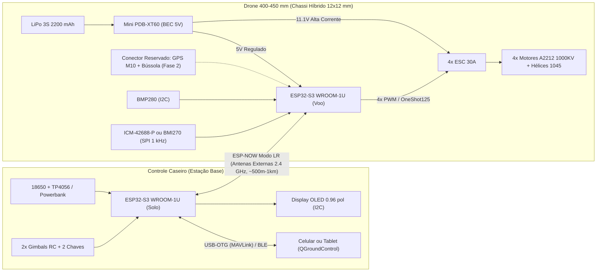

# Especificação de Arquitetura & Engenharia: Quadricóptero 450 mm DIY com ESP32-S3

Este documento consolida todas as decisões definidas na etapa de alinhamento em uma **arquitetura de engenharia completa, verificada e pronta para execução** — cobrindo mecânica (sem impressora 3D), eletrônica (sem PCB custom), pinagem sem conflitos, lista de compras (BOM), orçamento de peso/empuxo, arquitetura de software (C++ / FreeRTOS / ESP-NOW / MAVLink) e roadmap seguro de testes.

---

## 1. Resumo da Arquitetura Fechada



---

## 2. Orçamento de Massa e Empuxo (Cálculo de Viabilidade)

Antes de comprar qualquer peça, validamos se o drone vai voar com folga ao ar livre e aguentar o upgrade futuro de GPS:

| Subsistema | Peso Estimado (g) | Observações |
| :--- | :---: | :--- |
| Chassi 12×12 mm (madeira ou alumínio) + 2 chapas compensado 4 mm + parafusos M3 | ~190–230 g | Madeira ~190 g; Alumínio parede 1 mm ~225 g |
| Trem de pouso leve (espuma isolante / alças PVC) | ~25–35 g | Absorve impacto em pousos duros |
| 4× Motores A2212 1000KV (c/ adaptador e cruzeta) | ~220 g | ~55 g cada |
| 4× ESC 30A | ~100 g | ~25 g cada |
| 4× Hélices 1045 | ~45 g | ~11 g cada |
| Mini PDB + Placa perfurada + ESP32-S3 + Antena + IMU + BMP280 + Fios + Capacitor | ~95 g | Montado em sanduíche compacto |
| Bateria LiPo 3S 2200 mAh 30C–40C | ~185 g | Principal massa (fica no CG central!) |
| **TOTAL PRONTO P/ VOO (Fase 1)** | **~860–910 g** | **Excelente para classe 450 mm** |
| *Upgrade Fase 2: GPS u-blox M10 + Bússola + Mastro* | *+45 g* | *Total Fase 2: ~910–955 g* |

### Relação Empuxo / Peso
- **Empuxo máximo de 1× motor A2212 1000KV + hélice 1045 em 3S:** ~700 a 800 g (a ~12–14 A).
- **Empuxo total (4 motores):** **~2.800 a 3.200 g**.
- **Relação Empuxo/Peso:** **~3,1 : 1 a 3,5 : 1** (o mínimo recomendado é 2 : 1).
- **Na prática:** O drone vai pairar (*hover*) com apenas **~35% a 42% do acelerador**, deixando enorme margem para correções contra vento externo, estabilidade e autonomia estimada de **10 a 14 minutos** por carga.

---

## 3. Lista Completa de Materiais (BOM — Fase 1 + Extras)

### A) Eletrônica & Propulsão do Drone
| Item | Especificação Recomendada | Qtd | Custo Est. (R\$) | Notas Técnicas |
| :--- | :--- | :---: | :---: | :--- |
| **Microcontrolador** | **ESP32-S3-DevKitC-1 versão WROOM-1U** (conector IPEX/U.FL) | 1 | 45–65 | Conferir se o módulo termina em **"U"** (IPEX)! |
| **Antena Externa** | Kit Pigtail IPEX→SMA + Antena 2.4 GHz 3–5 dBi | 1 | 15–25 | Usar antena omnidirecional 2.4 GHz |
| **IMU (Principal)** | Módulo **ICM-42688-P** (ou **BMI270**) c/ pinos SPI | 1 | 30–50 | Evitar MPU-6050 no 450 mm |
| **Barômetro** | Módulo **BMP280** (3,3 V, I2C) | 1 | 10–15 | Colocar espuma preta sobre o chip p/ bloquear vento |
| **Motores Brushless** | **A2212 1000KV** (eixo 3,17 mm + cruzeta + adaptador) | 4 | 130–180 | Comprar kit com 4 (se puder, +1 reserva) |
| **ESCs** | **ESC 30A** (2S–4S, firmware SimonK ou BLHeli) | 4 | 120–180 | Muitos kits já vendem 4× A2212 + 4× ESC 30A juntos! |
| **Hélices** | **1045** (10×4,5", Nylon/ABS — metade CW, metade CCW) | 8 (4 pares) | 35–55 | **Sempre compre pares extras!** |
| **Distribuição de Energia** | **Mini PDB-XT60** pronta com BEC 5 V (ex.: Matek/Genérica) | 1 | 18–28 | Isola alta corrente e alimenta ESP32 com 5 V limpo |
| **Capacitor de Filtro** | Eletrolítico **470 µF ou 1000 µF / 25 V Low-ESR** | 1 | 4–8 | Soldar direto nos pads da bateria na PDB |
| **Placa Controladora** | Placa universal perfurada fenolite/fibra **5×7 cm** + barras de pinos fêmea/macho | 1 kit | 15–20 | Permite espetar/trocar ESP32 e sensores sem dessoldar |
| **Componentes Auxiliares** | 2× Resistores (33 kΩ e 10 kΩ, 1/4 W), 1× Cap 100 nF, 1× Buzzer ativo 5 V (módulo 3 pinos), Fita 3M VHB espuma | 1 kit | 20–30 | Divisor p/ monitorar bateria 3S + isolamento IMU |

### B) Chassi Híbrido 12×12 mm (Sem Impressora 3D)
| Item | Especificação | Qtd | Custo Est. (R\$) | Onde achar |
| :--- | :--- | :---: | :---: | :--- |
| **Braços Fase 1** | Sarrafo quadrado bem reto **12×12 mm** (Pinus seco / Caixeta / Marfim) — 1 metro | 1 m | 8–15 | Madeireira / Leroy Merlin |
| **Braços Fase 2 (opcional)** | Tubo quadrado de **Alumínio 12×12 mm** (parede 1 mm) — 1 metro | 1 m | 18–28 | Serralheria / Casa de ferragens |
| **Chapas Centrais** | Compensado **4 mm** (cortar 2 quadrados de 11×11 cm ou octógonos) | 1 retalho | 5–15 | Madeireira / Papelaria técnica |
| **Fixação** | Parafusos **M3×25 mm** (16×), **M3×10 mm** (16× p/ motores), Porcas travantes **M3 Parlock/Nyloc** (32×), Arruelas M3 (32×) | 1 kit | 15–25 | Loja de parafusos |
| **Acabamento / Pouso** | Abraçadeiras nylon (enforca-gato), fita velcro p/ bateria, tubo de espuma isolante p/ pés | 1 kit | 15–20 | Ferragens / Material de construção |

### C) Controle Caseiro (Estação Base + Ponte MAVLink)
| Item | Especificação | Qtd | Custo Est. (R\$) | Notas Técnicas |
| :--- | :--- | :---: | :---: | :--- |
| **Microcontrolador** | **ESP32-S3-DevKitC-1 versão WROOM-1U** | 1 | 45–65 | Mesmo modelo do drone! |
| **Antena Externa** | Kit Pigtail IPEX→SMA + Antena 2.4 GHz 3–5 dBi | 1 | 15–25 | Pode usar antena 5 dBi na base |
| **Gimbals RC** | Par de **Gimbals de reposição de rádio RC** (1 c/ mola em 2 eixos, 1 sem mola no vertical p/ Throttle) | 1 par | 35–60 | Conferir se são potenciômetros lineares (ex.: 5 kΩ ou 10 kΩ) |
| **Display** | Mini **OLED 0,96" SSD1306** (I2C, 128×64) | 1 | 15–22 | Bateria do drone, RSSI, modo de voo e status ARMED |
| **Chaves / Botões** | 1× Chave alavanca 2 posições (**ARM / Kill-Switch**), 1× Chave 3 posições (**Modo de Voo**), 1× Push-button, 1× Buzzer 3,3 V/5 V | 1 kit | 15–20 | Chave física de corte salva dedos e hélices! |
| **Alimentação do Controle** | 1× Célula **18650** + suporte + carregador **TP4056** + mini boost 5 V **OU** um Powerbank USB comum | 1 | 25–40 | Se já tiver powerbank, custo R\$ 0 |
| **Caixa / Montagem** | Caixa patola plástica (~16×10×5 cm) ou compensado fino + placa perfurada | 1 | 20–30 | Fácil de furar para gimbals, chaves e OLED |
| **Cabo p/ Celular/Tablet** | Cabo **USB-C ↔ USB-C** (ou adaptador OTG) de dados | 1 | 15–20 | Conecta direto no QGroundControl (Android) |

### D) Bateria LiPo & Carregador (Essenciais)
| Item | Especificação | Qtd | Custo Est. (R\$) | Notas de Segurança |
| :--- | :--- | :---: | :---: | :--- |
| **Bateria do Drone** | LiPo **3S (11,1 V) 2200 mAh 30C ou 40C** com conector **XT60** | 1 | 130–180 | Nunca usar célula 18650 comum no drone! |
| **Carregador** | **iMAX B6** (ideal: carrega, balanceia e coloca em modo *Storage* 3,85 V/célula) ou **B3 Pro** (mais barato) | 1 | 60–160 | iMAX B6 aumenta muito a vida útil da LiPo |
| **Alarme / Medidor LiPo** | *LiPo Buzzer / Cell Checker* (opcional mas muito útil) | 1 | 15–25 | Mede cada célula individualmente |

### E) Reservado para Fase 2 (Comprar depois do 1º voo estável)
- **Módulo GPS + Bússola:** **u-blox M10** com magnetômetro **QMC5883L** integrado (ex.: BZGNSS BZ-251 / HGLRC M100 Pro / M10Q-5883) + haste/mastro simples de canudinho rígido/vareta (~R\$ 85–130).

> **Resumo do Orçamento Estimado (Fase 1 completa, sem GPS):**
> - **Drone + Chassi + Controle Caseiro:** ~R\$ 630 a R\$ 890
> - **Bateria 3S + Carregador:** ~R\$ 190 a R\$ 340
> - **Total geral completo:** **~R\$ 820 a R\$ 1.230** *(pode cair bastante comprando combo A2212+ESC30A+Hélices e importando parte dos sensores/ESP32)*.

---

## 4. Pinagem Verificada (ESP32-S3-WROOM-1U — Sem Conflitos!)

> [!IMPORTANT]
> No **ESP32-S3**, **nunca** use `GPIO0`, `GPIO3`, `GPIO45`, `GPIO46` (*strapping pins* de boot), `GPIO19`/`GPIO20` (reservados ao USB-C nativo) nem `GPIO26`–`GPIO37` (usados por Flash/PSRAM Octal em modelos R8). Além disso, **use apenas canais do ADC1 (`GPIO1`–`GPIO10`)**, pois o ADC2 falha quando o rádio Wi-Fi/ESP-NOW está ativo!

### A) Pinagem do Drone (`drone_fc`)
| GPIO ESP32-S3 | Função | Periférico | Notas de Ligação |
| :---: | :--- | :--- | :--- |
| **GPIO4** | Motor 1 — **Frente-Direita (FR, CCW)** | LEDC / MCPWM | Apenas **Sinal + GND** do ESC 1 (isolar fio vermelho 5 V!) |
| **GPIO5** | Motor 2 — **Traseira-Direita (RR, CW)** | LEDC / MCPWM | Apenas **Sinal + GND** do ESC 2 |
| **GPIO6** | Motor 3 — **Traseira-Esquerda (RL, CCW)** | LEDC / MCPWM | Apenas **Sinal + GND** do ESC 3 |
| **GPIO7** | Motor 4 — **Frente-Esquerda (FL, CW)** | LEDC / MCPWM | Apenas **Sinal + GND** do ESC 4 |
| **GPIO10** | IMU `CS` | SPI2 (FSPI) | Chip Select do ICM-42688-P / BMI270 |
| **GPIO11** | IMU `MOSI` (SDA/SDI) | SPI2 (FSPI) | Clock SPI recomendado: 8–10 MHz |
| **GPIO12** | IMU `SCK` (SCL) | SPI2 (FSPI) | |
| **GPIO13** | IMU `MISO` (SDO/AD0) | SPI2 (FSPI) | |
| **GPIO14** | IMU `INT1` (Data Ready) | Interrupção | Opcional — dispara leitura exata a 1 kHz |
| **GPIO8** | `I2C_SDA` | I2C0 (400 kHz) | **BMP280** + futuro **QMC5883L** (header Fase 2) |
| **GPIO9** | `I2C_SCL` | I2C0 (400 kHz) | |
| **GPIO17** | `GPS_TX` (vai no RX do GPS) | UART1 | **Reservado no conector de 6 pinos (Fase 2)** |
| **GPIO18** | `GPS_RX` (vai no TX do GPS) | UART1 | **Reservado no conector de 6 pinos (Fase 2)** |
| **GPIO1** | Leitura Tensão Bateria 3S | ADC1_CH0 | Divisor **33 kΩ** (de `VBAT`) + **10 kΩ** (p/ `GND`) + cap 100 nF → 12,6 V = 2,93 V |
| **GPIO21** | Buzzer de Alerta | Digital OUT | Módulo buzzer ativo (bateria baixa / failsafe / armar) |
| **GPIO48** | LED RGB Status | Onboard | Vermelho = Disarmed, Verde = Armed, Piscando = Failsafe |
| **GPIO19 / 20** | USB-C Nativo | USB CDC | Programação, CLI e calibração na bancada |

> [!CAUTION]
> **Regra de Alimentação dos ESCs:** Como a **Mini PDB** vai fornecer **5 V regulado** para o pino `5V` (VIN) do ESP32-S3, **remova ou isole o fio vermelho (+5 V) do conector de sinal de TODOS os 4 ESCs** (deixe conectados apenas o fio branco/amarelo de sinal e o fio preto/marrom de GND). Isso evita curto/conflito entre reguladores!

### B) Pinagem do Controle Caseiro (`ground_tx`)
| GPIO ESP32-S3 | Função | Periférico | Notas de Ligação |
| :---: | :--- | :--- | :--- |
| **GPIO1** | Gimbal Esq. Vertical — **Throttle** (sem mola) | ADC1_CH0 | Alimentar potenciômetros com **3,3 V** do ESP32-S3! |
| **GPIO2** | Gimbal Esq. Horizontal — **Yaw** | ADC1_CH1 | |
| **GPIO4** | Gimbal Dir. Vertical — **Pitch** | ADC1_CH3 | |
| **GPIO5** | Gimbal Dir. Horizontal — **Roll** | ADC1_CH4 | |
| **GPIO6** | Tensão Bateria 18650 do Controle | ADC1_CH5 | Divisor **100 kΩ + 100 kΩ** (4,2 V → 2,1 V) |
| **GPIO8 / 9** | Display **OLED 0,96" SSD1306** | I2C0 | `SDA = GPIO8`, `SCL = GPIO9` |
| **GPIO10** | Chave Física **ARM / KILL-SWITCH** | Digital IN | `INPUT_PULLUP` → fechado p/ GND = ARMED (fio solto desarma!) |
| **GPIO11 / 12** | Chave 3 Posições **Modo de Voo** | Digital IN | `INPUT_PULLUP` → Stabilize / AltHold / GPS-RTH |
| **GPIO13** | Botão Auxiliar (Trim / RTH) | Digital IN | `INPUT_PULLUP` |
| **GPIO14** | Buzzer do Controle | Digital OUT | Bipa se bateria do drone < 10,8 V ou RSSI fraco |
| **GPIO19 / 20** | **USB-C Nativo → Celular/Tablet** | USB CDC | Ponte **MAVLink v2** direto para **QGroundControl** (USB-OTG) |

---

## 5. Projeto Mecânico do Chassi Híbrido 12×12 mm (Sem Impressora 3D)

```
       (M4: FL - CW)                 (M1: FR - CCW)
             \                           /
              \   21 cm         21 cm   /
               \      +---------+      /
                \     |  11x11  |     /
                 >====|  Centro |====<   (Distância diagonal motor-a-motor: ~420 mm)
                /     | Comp.4mm|     \
               /      +---------+      \
              /   21 cm         21 cm   \
             /                           \
       (M3: RL - CCW)                (M2: RR - CW)
```

### Diretrizes de Construção
1. **Geometria em "X" Verdadeiro (420 mm diagonal):**
   - Corte **4 braços idênticos de 21 cm** (do sarrafo de madeira 12×12 mm na Fase 1; depois, os mesmos 21 cm em alumínio 12×12 mm).
   - Corte **2 chapas centrais de compensado 4 mm** medindo **11×11 cm** (pode chanfrar os 4 cantos formando um octógono para economizar peso e ficar com visual profissional).
   - Os 4 braços entram **4 cm** para dentro do sanduíche das duas chapas (em ângulos exatos de 90° entre si, marcados com esquadro escolar!), deixando um vão quadrado livre no meio para passar cabos e fixando cada braço com **2 parafusos M3×25 mm + arruelas + porcas travantes (Parlock)**.
2. **Montagem dos Motores A2212:**
   - Na ponta de cada braço (a 1,5 cm da extremidade), faça os furos alinhados com a cruzeta do A2212 (ou 2 furos atravessando o perfil 12×12 mm) usando parafusos M3 e arruelas. Confira visualmente numa mesa plana se todos os 4 eixos apontam **perfeitamente na vertical**.
3. **Empilhamento Limpo ("Sanduíche" de 3 Camadas):**
   - **Embaixo da chapa inferior:** Bateria LiPo 3S presa com cinta de velcro + almofadinha de EVA (mantém o Centro de Gravidade centralizado e estável).
   - **Sobre a chapa superior (camada 1):** Mini PDB-XT60 presa com espaçadores de nylon ou fita dupla-face isolante; os 4 ESCs ficam presos com abraçadeiras de nylon ao longo dos 4 braços (pegam vento das hélices para resfriar!).
   - **Acima da PDB (camada 2):** Placa universal perfurada (5×7 cm) apoiada sobre **4 quadradinhos de espuma dupla-face grossa 3M VHB** (isolamento mecânico contra vibrações!), com a **IMU exatamente no centro geométrico** e com a seta de orientação apontando para a frente.
   - **Antena 2.4 GHz:** Fixada verticalmente num dos pés ou lateral, afastada da bateria LiPo (que bloqueia sinal de 2.4 GHz!).

---

## 6. Arquitetura do Firmware (C++ / PlatformIO + FreeRTOS + MAVLink)

Organizaremos o código num **único repositório PlatformIO** com 3 módulos:

```text
esp32-quad450/
├── shared/
│   └── radio_protocol.h      # Structs compactas ESP-NOW (RC uplink + Telemetria downlink + CRC16)
├── drone_fc/                 # Firmware do ESP32-S3 do Drone
│   ├── src/
│   │   ├── main.cpp          # Inicialização e criação das Tasks FreeRTOS (Core 0 e Core 1)
│   │   ├── imu_driver.cpp    # Leitura SPI rápida (ICM-42688-P / BMI270) + calibração de bias
│   │   ├── ahrs.cpp          # Filtro Passa-Baixa PT1/Biquad + Filtro de Mahony/Madgwick
│   │   ├── pid_controller.cpp# PID em cascata (Ângulo -> Taxa) com D-on-Measurement e anti-windup
│   │   ├── mixer_esc.cpp     # Mixer X + saída PWM 400 Hz / OneShot125 + rotina de calibração ESC
│   │   ├── radio_rx.cpp      # ESP-NOW RX/TX + Failsafe (corte/pouso se > 500 ms sem sinal)
│   │   ├── baro_alt.cpp      # Leitura BMP280 + filtro de altitude (Fase 2)
│   │   └── gps_nav.cpp       # Parser GPS M10 + PosHold/RTH (Fase 2)
└── ground_tx/                # Firmware do ESP32-S3 do Controle Caseiro
    └── src/
        ├── main.cpp          # Loop 100 Hz: lê gimbals/chaves -> ESP-NOW -> OLED -> MAVLink
        ├── inputs.cpp        # Calibração ADC1, média móvel, deadband, failsafe de chave
        ├── oled_ui.cpp       # Tela 128x64: bateria drone/TX, RSSI, ângulos, modo, ARMED
        └── mavlink_bridge.cpp# Traduz telemetria <-> MAVLink v2 (QGroundControl via USB-OTG)
```

### Separação de Núcleos no ESP32-S3 do Drone (Crítico para Estabilidade!)
- **Core 1 — Task `FlightLoopTask` (Prioridade Máxima, 500 Hz ou 1 kHz):**
  1. Lê giroscópio + acelerômetro via SPI (sem bloqueios, sem `Serial.print()`).
  2. Aplica filtro passa-baixa no giroscópio (~80–100 Hz) e atualiza atitude (**Mahony/Madgwick**).
  3. Executa **PID em Cascata** (Roll/Pitch: Ângulo → Taxa; Yaw: Taxa).
  4. Calcula **Mixer X** e atualiza os 4 canais PWM/OneShot125 dos ESCs.
- **Core 0 — Tasks de Comunicação & Sensores Lentos:**
  - Pilha **Wi-Fi / ESP-NOW** (recebe pacote RC ~50–100 Hz; devolve pacote de telemetria a 15–20 Hz).
  - Leitura **BMP280** (25 Hz), tensão **ADC bateria** (10 Hz), **GPS UART** (10 Hz na Fase 2), **Buzzer/LED** e gravação de parâmetros PID ajustados pelo QGroundControl na memória NVS (`Preferences`)!

### Como Funciona o Ajuste de PID pelo Celular/Tablet (MAVLink)
O controle caseiro expõe parâmetros MAVLink (`PID_ROLL_P`, `PID_ROLL_I`, `PID_ROLL_D`, `PID_ANG_P`, etc.) para o **QGroundControl**. Quando você altera um ganho no tablet, o controle envia um comando especial pelo ESP-NOW para o drone, que atualiza o ganho em RAM (e salva na NVS quando desarmado) — **você ajusta o PID em campo sem precisar plugar o cabo USB no drone a cada teste!**

---

## 7. Roadmap de Execução em 6 Fases (Seguro e Progressivo)

1. **Fase 0 — Compras & Bancada de Software (Antes de ter todas as peças):**
   - Criar o repositório PlatformIO com a arquitetura acima e validar compilação + protocolo ESP-NOW entre os dois ESP32-S3 na mesa (já vendo telemetria no OLED e no QGroundControl!).
2. **Fase 1 — Montagem Mecânica + Controle Caseiro:**
   - Construir o chassi 12×12 mm (braços de madeira), soldar a Mini PDB + ESCs, montar a placa perfurada com ESP32-S3 + IMU + BMP280, e montar a caixa do controle caseiro.
3. **Fase 2 — Testes de Bancada SEM HÉLICES (Obrigatório!):**
   - Calibrar os 4 ESCs (faixa 1000–2000 µs), verificar sentido de giro de cada motor (M1/M3 CCW, M2/M4 CW), validar que o Kill-Switch desarma em < 10 ms e que o Failsafe corta motores se desligar o controle.
   - Checar ruído da IMU com os motores girando sem hélice (validação de vibração).
4. **Fase 3 — Bancada "Gangorra 1-Eixo" (Tuning Seguro de PID):**
   - Prender o drone numa barra articulada simples (2 pedaços de madeira + 1 eixo/parafuso longo permitindo girar livremente apenas em Roll, depois em Pitch).
   - Colocar as hélices **somente nessa bancada firme** e sintonizar os ganhos P, I, D ao vivo pelo QGroundControl até o drone se nivelar sozinho mesmo quando você empurra um braço com uma vareta!
5. **Fase 4 — Primeiro Voo Livre (Modo Stabilize):**
   - Em área aberta e gramada (sem pessoas perto), voar a 1 metro de altura testando pairado, resposta dos gimbals, tensão da bateria e alcance do ESP-NOW com monitoramento de RSSI no OLED/QGroundControl.
6. **Fase 5 — Altitude Hold (BMP280) → Fase 6 — Upgrade GPS M10 + Bússola + Alumínio:**
   - Implementar *Altitude Hold* fundindo acelerômetro Z + BMP280.
   - Plugar o módulo **GPS u-blox M10 + QMC5883L** no conector reservado de 6 pinos para ver o drone no mapa de satélite do QGroundControl e implementar *Position Hold* e *Return-to-Home (RTH)*.
   - Opcionalmente trocar os 4 braços de madeira por alumínio 12×12 mm nos mesmos furos!

---

> [!TIP]
> **Próxima decisão prática:** Com esta arquitetura validada, podemos (1) revisar ou ajustar algum detalhe da BOM/custos, (2) já gerar o **código inicial completo em PlatformIO** (`shared/`, `drone_fc/`, `ground_tx/`), ou (3) detalhar o **gabarito de corte/furação do chassi 12×12 mm e o diagrama de soldagem da placa perfurada**.
