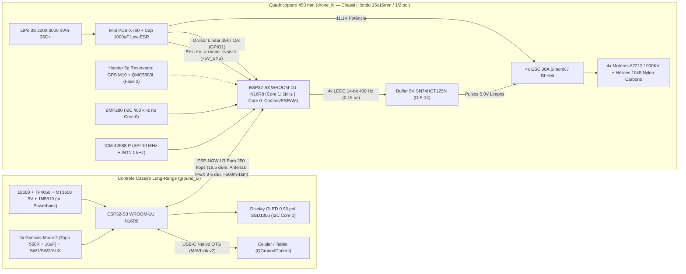

# Visão Geral da Arquitetura do Sistema v2.1 — Quadricóptero 450 mm DIY com ESP32-S3

Este documento apresenta a **visão executiva integrada** do projeto **ESP32-S3 Quad-450 (Fase 1 Completa — Sem GPS)** na revisão unificada **v2.1**, conectando mecânica sem impressora 3D, eletrônica em placa perfurada `7×9 cm` FR4, pinagem verificada sem conflitos e arquitetura Dual-Core + MAVLink v2.

> [!IMPORTANT]
> **Documentos Especializados desta Suíte v2.1 (100% Unificados):**
> - **Cálculos de Engenharia, FMEA (14 Armadilhas Mitigadas) & Lista de Compras (BOM v2.1):** [validacao_engenharia_e_bom_otimizada.md](validacao_engenharia_e_bom_otimizada.md)
> - **Gabaritos de Corte/Furação, Soldagem Ponto-a-Ponto & 8 Portões de Validação:** [manual_montagem_detalhado_450.md](manual_montagem_detalhado_450.md)
> - **Arquitetura Hexagonal C++17, Equações de Controle, Bode & Protocolos:** [arquitetura_software_esp32s3.md](arquitetura_software_esp32s3.md)

---

## 1. Diagrama Geral da Arquitetura Fechada (`v2.1`)

---

## 2. Resumo das Especificações Físicas e de Desempenho (`v2.1`)

| Parâmetro do Sistema | Especificação Oficial `v2.1` | Margem / Benefício de Engenharia |
| :--- | :--- | :--- |
| **Diagonal Motor-a-Motor** | **`450,0 mm` (`Quad-X` verdadeiro, raio `225 mm`)** | `64,2 mm` de folga entre hélices `1045` e círculo central livre de `Ø 196 mm` |
| **Chapas Centrais** | **2× `120 × 120 mm` em compensado naval `4 mm`** | Sanduíche rígido com furos dos braços em `r = 32 mm` e `r = 68 mm` |
| **Braços (`225 mm` cada)** | **Madeira maciça `15×15 mm`** (mínimo) ou **Alumínio `1/2"` (`12,7 mm`) c/ buchas `55 mm`** | $f_{n1} = 101,3\text{ Hz}$ (madeira `15 mm`) / $137,2\text{ Hz}$ (alumínio), bem acima do *hover* `71 Hz`! |
| **Placa Controladora & Dampers** | **FR4 perfurada `70 × 90 mm`**, dampers M3 em **`(±22, ±41) mm`** | Distância perpendicular $d_\perp = 13,44\text{ mm}$ → zero colisão com os braços diagonais! |
| **Massa Total & Empuxo** | **`~890–912 g` (`AUW`)** vs **`~3.080 gf` empuxo máx.** | Relação Empuxo/Peso **`3,4 : 1`**, *hover* em `~30%`, autonomia real **`8,2 a 12,5 min`** |
| **IMU & Barômetro** | **`ICM-42688-P` SPI (`1000 Hz` nativo)** + **`BMP280` I2C (`40 Hz`)** | Ruído `2,8 mdps/√Hz`, sem *blob* de `8 KB`, fusão vertical de 3 estados (`z, vz, bias_az`) |
| **Enlace de Rádio** | **`ESP-NOW LR` puro @ `250 kbps` (`+19,5 dBm`, Canal 1)** | Sensibilidade `-105 dBm` → margem de **`+26,8 dB` a `500 m`** e **`+20,8 dB` a `1 km`** |
| **Caixa-Preta Onboard** | **`6,5 MB` na Octal PSRAM (`106.496` quadros @ `500 Hz`)** | `3,5 minutos` contínuos de telemetria interna de alta frequência p/ análise FFT em Python |

---

## 3. Tabela Consolidada de Pinagem (`ESP32-S3-DevKitC-1 N16R8` — Zero Conflitos!)

> [!CAUTION]
> **Pinos Proibidos Respeitados Rigorosamente:** Nenhum sinal usa *strapping pins* (`GPIO0, 3, 45, 46`), USB nativo (`GPIO19, 20` — dedicados ao CLI/MAVLink), barramentos internos de Flash/Octal PSRAM (`GPIO26..37`) nem o conversor `ADC2` (incompatível com Wi-Fi). Todas as entradas analógicas estão no **`ADC1`** dimensionadas abaixo de **`2,90 V`**!

### 3.1 Pinagem da Controladora de Voo (`drone_fc`)
| Pino ESP32-S3 | Função | Periférico / Core | Ligação Exata na Placa `70 × 90 mm` (`v2.1`) |
| :---: | :--- | :--- | :--- |
| **`GPIO1`** | Tensão Bateria `3S` (`VBAT`) | `ADC1_CH0` (Core 0, 50 Hz) | Divisor **`39 kΩ` (`BAT+`) / `10 kΩ` (`GND`) + `100 nF`** (`12,6 V → 2,57 V`) |
| **`GPIO4`** | Motor 1 — **Frente-Direita (`FR, CCW ↺`)** | `LEDC` 14-bit 400 Hz (Core 1) | Pull-down `10k` → `SN74HCT125N` Pino `2` (`1A`) → Saída `5V` Pino `3` (`1Y`) |
| **`GPIO5`** | Motor 2 — **Traseira-Direita (`RR, CW ↻`)** | `LEDC` 14-bit 400 Hz (Core 1) | Pull-down `10k` → `SN74HCT125N` Pino `5` (`2A`) → Saída `5V` Pino `6` (`2Y`) |
| **`GPIO6`** | Motor 3 — **Traseira-Esquerda (`RL, CCW ↺`)** | `LEDC` 14-bit 400 Hz (Core 1) | Pull-down `10k` → `SN74HCT125N` Pino `9` (`3A`) → Saída `5V` Pino `8` (`3Y`) |
| **`GPIO7`** | Motor 4 — **Frente-Esquerda (`FL, CW ↻`)** | `LEDC` 14-bit 400 Hz (Core 1) | Pull-down `10k` → `SN74HCT125N` Pino `12` (`4A`) → Saída `5V` Pino `11` (`4Y`) |
| **`GPIO8 / 9`** | `I2C_SDA` (`8`) / `I2C_SCL` (`9`) | `I2C0` 400 kHz (**Core 0**) | **`BMP280`** (`3,3 V`) + Header 6p Fase 2 (`QMC5883L`) |
| **`GPIO10..13`** | `CS(10), MOSI(11), SCK(12), MISO(13)` | `FSPI` 10 MHz (**Core 1**) | **`ICM-42688-P`** (`3,3 V`, fios `< 4 cm`, `FSYNC → GND`) |
| **`GPIO14`** | `IMU_INT1` (*Data Ready* `1000 Hz`) | ISR `IRAM` → `Flight1kHz` | Disparo determinístico exato da malha de controle no Core 1 |
| **`GPIO17 / 18`** | `GPS_TX(17)` / `GPS_RX(18)` | `UART1` (Reservado Fase 2) | Pinos `3` e `4` do Header de 6 pinos p/ futuro `u-blox M10` |
| **`GPIO21`** | Buzzer de Alerta / Sirene | Digital OUT (Core 0) | Módulo **`KY-012` (`NPN Active-HIGH`)** em `+5V_SYS` |
| **`GPIO48 / 38`** | LED RGB Onboard (`v1.0` e `v1.1`) | `RMT` sob mudança (Core 0) | **Verde** = Pronto | **Vermelho** = Armado! | **Azul** = PreArm | **Roxo** = Failsafe |
| **`GPIO19 / 20`** | Porta `USB` Nativa | `HWCDC` USB-C | Gravação e `BenchCli` interativa (`115200 bps`) |

### 3.2 Pinagem do Controle Caseiro (`ground_tx`)
| Pino ESP32-S3 | Função | Periférico / Core | Ligação Exata no Controle (`v2.1`) |
| :---: | :--- | :--- | :--- |
| **`GPIO1`** | Stick Esq. Vertical — **Throttle** (s/ mola) | `ADC1_CH0` (Core 1, 100 Hz) | Cursor + `100 nF`; topo dos 4 pots em **`+V_POTS` (`3V3 → 560 Ω + 10 µF`)** |
| **`GPIO2`** | Stick Esq. Horizontal — **Yaw** (c/ mola) | `ADC1_CH1` (Core 1, 100 Hz) | Cursor + `100 nF` (`V_max <= 2,68 V`, zero saturação no `ADC1`!) |
| **`GPIO4`** | Stick Dir. Vertical — **Pitch** (c/ mola) | `ADC1_CH3` (Core 1, 100 Hz) | Cursor + `100 nF` |
| **`GPIO5`** | Stick Dir. Horizontal — **Roll** (c/ mola) | `ADC1_CH4` (Core 1, 100 Hz) | Cursor + `100 nF` |
| **`GPIO6`** | Tensão Bateria `18650` do Controle | `ADC1_CH5` (Core 1, 10 Hz) | Divisor **`100 kΩ + 100 kΩ` + `100 nF`** (`4,2 V → 2,1 V`) |
| **`GPIO8 / 9`** | Display **OLED `0,96"` `SSD1306`** | `I2C0` 400 kHz (**Core 0**) | Renderização paginada `128 B/10 ms` sem bloquear CPU |
| **`GPIO10`** | Chave Física **`SW1` (`ARM / KILL`)** | `INPUT_PULLUP` (Core 1) | Aberto = **`SAFE / DISARMED`**; fechado p/ `GND` = `ARM` |
| **`GPIO11 / 12`** | Chave 3 Posições **`SW2` (`Modos`)** | `INPUT_PULLUP` (Core 1) | `11=GND`: **`STAB`** | Centro: **`ALTH`** | `12=GND`: **`CINE` (`±20°`)** |
| **`GPIO13`** | Botão **`[AUX]`** | `INPUT_PULLUP` (Core 1) | Boot = **Wizard Calibração Gimbals**; Segurar `1,5 s` desarmado = **Salvar NVS Drone** |
| **`GPIO14`** | Buzzer do Controle | Digital OUT (Core 0) | Alerta sonoro de bateria `3S < 10,6 V`, `TX < 3,45 V` ou `Failsafe` |
| **`GPIO19 / 20`** | Porta `USB` Nativa → **QGroundControl** | `HWCDC` USB-OTG (Core 0) | Ponte bidirecional **MAVLink v2** (Horizonte + 19 Parâmetros ao vivo!) |

---

## 4. Fluxo de Execução Recomendado (Do Zero ao Primeiro Voo Livre)

1. **Simulação no PC (Hoje, antes mesmo das compras chegarem):** Rode `pio test -e native_test` e conecte o simulador `./.pio/build/sitl_pc/program` ao **QGroundControl** para praticar a leitura de telemetria e o ajuste dos 19 parâmetros.
2. **Compras Verificadas (`BOM v2.1`):** Siga as Tabelas 1 a 4 e o Checklist de Recebimento em [validacao_engenharia_e_bom_otimizada.md](validacao_engenharia_e_bom_otimizada.md).
3. **Construção com Portões 1 a 4 (Multímetro):** Monte o chassi `450 mm`, a PDB, a placa `70×90 mm` FR4 e o Controle Caseiro validando tensões e isolação em [manual_montagem_detalhado_450.md](manual_montagem_detalhado_450.md).
4. **Comissionamento Seguro nos Portões 5 a 8:** Confira os sinais `FRD` (`imu_test`), o giro dos motores sem hélices (`motor_test`), o espectro FFT da Blackbox, a **Bancada Gangorra 1-Eixo** e realize o primeiro voo livre!
