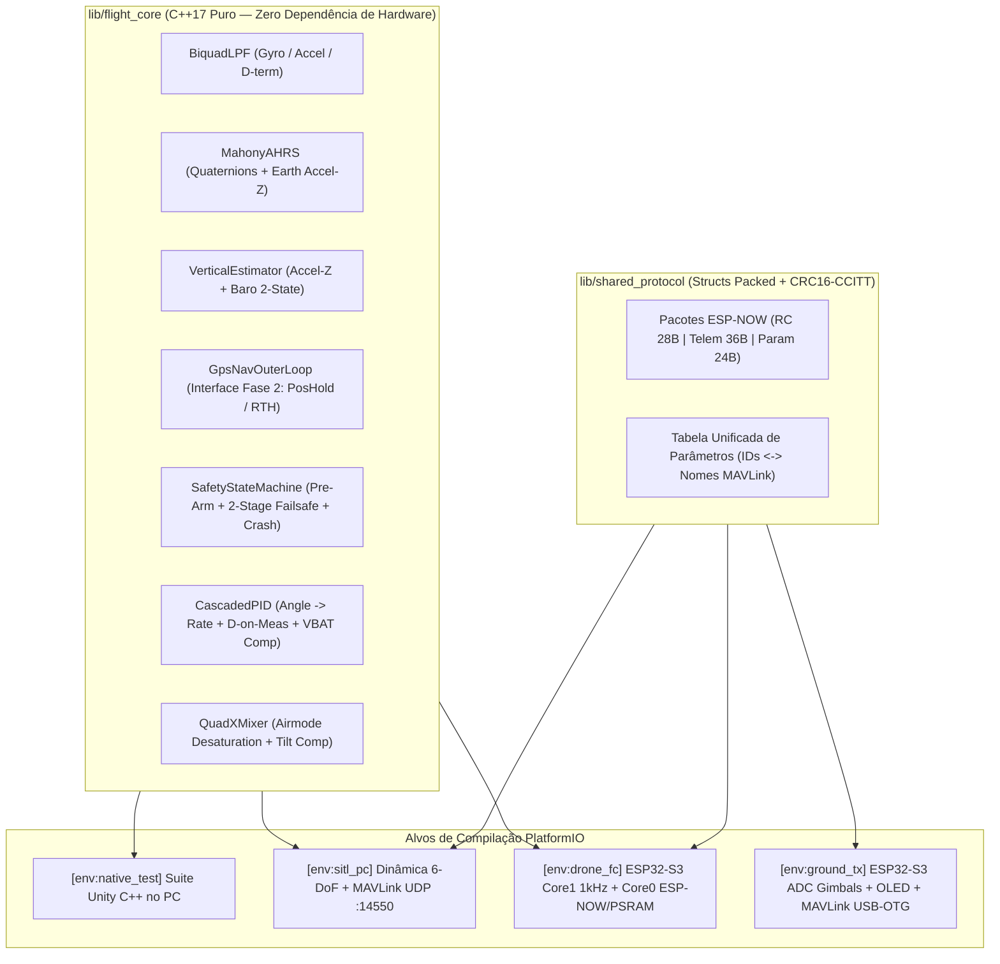
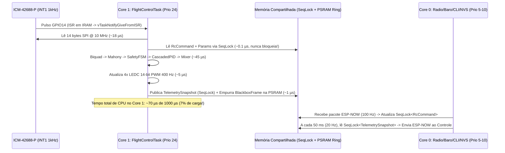
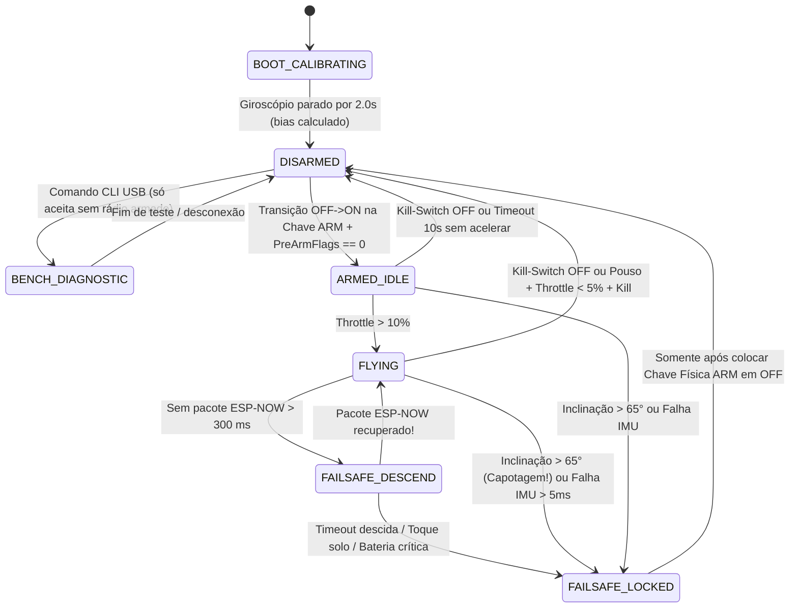

# Plano de Arquitetura e Engenharia de Software — Quadricóptero 450 mm ESP32-S3

Este documento é a **especificação mestre de engenharia de software** do projeto. Ele define a organização do repositório, contratos de camadas (HAL), modelo de tempo real *lock-free* no FreeRTOS, convenção matemática de eixos, equações de controle, máquina de estados de segurança, layout binário do protocolo ESP-NOW LR, tradução MAVLink v2, Caixa-Preta na PSRAM, simulador físico SITL 6-DoF e o roteiro de **Pair-Programming Guiado** em 7 Sprints.

---

## 1. Visão Geral da Arquitetura em Camadas (Hexagonal / Clean Embedded)

A regra número 1 do projeto é: **`lib/flight_core` não sabe que o ESP32 existe**. Ele contém apenas C++17 determinístico (`float`, tipos de largura fixa, sem `malloc`/`new`, sem `Arduino.h`), permitindo rodar **exatamente o mesmo código de voo** em 3 mundos:
1. **Testes Unitários Nativos (`native_test`):** Valida matemática, PID, mixer e *failsafes* em `< 1 s` no PC.
2. **Simulador Físico 6-DoF (`sitl_pc`):** Voa um modelo virtual do nosso drone de 900 g conectado ao **QGroundControl** no PC via UDP.
3. **Hardware Real (`drone_fc` + `ground_tx`):** Roda nos dois **ESP32-S3 N16R8** em tempo real.



---

## 2. Estrutura do Monorepo PlatformIO

```text
esp32s3-quad450/
├── platformio.ini                  # 4 ambientes: native_test, sitl_pc, drone_fc, ground_tx
├── lib/
│   ├── flight_core/                # ★ VOCÊ VAI PROGRAMAR AQUI (Pair-Programming Guiado!)
│   │   ├── include/
│   │   │   ├── fc_types.h          # Eixos FRD, ImuSample, RcCommand, ControlOutput, SystemState
│   │   │   ├── biquad_lpf.h        # Filtro Butterworth 2ª ordem
│   │   │   ├── mahony_ahrs.h       # Fusão 6-DoF em Quaternions + projeção vertical
│   │   │   ├── pid_cascade.h       # PID Ângulo -> Taxa + anti-windup + D-on-measurement
│   │   │   ├── quad_mixer.h        # Mixer X com desaturação + compensação VBAT/inclinação
│   │   │   ├── safety_fsm.h        # Pre-Arm checks, Failsafe 2 estágios e detector >65°
│   │   │   ├── alt_estimator.h     # Fusão complementar 2 estados (Accel-Z + Baro) + AltHold PID
│   │   │   ├── nav_interface.h     # Contrato limpo p/ GPS UBX + Mag (PosHold / RTH na Fase 2)
│   │   │   └── flight_pipeline.h   # Orquestrador de 1 passo de 1 ms (step_1khz)
│   │   └── src/ ...
│   │
│   ├── shared_protocol/            # Protocolo binário aéreo + registro de parâmetros
│   │   ├── radio_packets.h         # Structs #pragma pack(1) + CRC-16-CCITT
│   │   └── param_registry.h        # ~26 parâmetros ajustáveis ao vivo pelo QGroundControl
│   │
│   └── hal_esp32s3/                # ★ INFRAESTRUTURA / DRIVERS (Entregues prontos p/ você usar!)
│       ├── seqlock.h               # Sincronização Lock-Free entre Core 0 e Core 1
│       ├── drv_icm42688_spi.h/.cpp # SPI 10 MHz + configuração ODR 1 kHz + pino INT1
│       ├── drv_bmp280_i2c.h/.cpp   # I2C 400 kHz não-bloqueante
│       ├── drv_esc_pwm.h/.cpp      # LEDC 14-bit @ 400 Hz (6.553 níveis entre 1000-2000 µs)
│       ├── drv_espnow_lr.h/.cpp    # Wi-Fi 802.11 LR Mode + callbacks TX/RX + RSSI
│       ├── blackbox_psram.h/.cpp   # Ring-buffer de 7 MB na Octal PSRAM + dump binário/CSV
│       └── bench_cli.h/.cpp        # Console interativo USB (imu_cal, esc_cal, motor_test, dump)
│
├── src/
│   ├── drone_fc/main.cpp           # Tasks FreeRTOS (Core 1 @ 1kHz + Core 0 @ Comms/Sensors/NVS)
│   ├── ground_tx/                  # Firmware completo do Controle Caseiro
│   │   ├── main.cpp
│   │   ├── gimbal_adc.cpp          # Oversampling 16x ADC1, calibração min/mid/max, deadband
│   │   ├── oled_hud.cpp            # Interface gráfica SSD1306 128x64 @ 15 FPS
│   │   └── mavlink_usb_bridge.cpp  # Tradutor bidirecional ESP-NOW <-> MAVLink v2 (USB CDC)
│   └── sitl_pc/                    # Simulador 6-DoF em C++ no PC
│       ├── main_sitl.cpp           # Loop tempo real + servidor UDP p/ QGroundControl (:14550)
│       └── quad_physics_6dof.cpp   # Massa 0.9kg, inércia, atraso motor 35ms, vibração 120Hz, baro
│
├── test/                           # Suíte TDD executada com `pio test -e native_test`
│   ├── test_biquad/
│   ├── test_mahony/
│   ├── test_pid_and_mixer/
│   └── test_safety_fsm/
│
└── tools/
    └── analyze_blackbox.py         # Gera gráficos de FFT de vibração, resposta PID e jitter dt_us
```

---

## 3. Convenção Única de Coordenadas e Sinais (Zero Inversões!)

> [!IMPORTANT]
> **90% das capotagens no primeiro voo de controladores caseiros acontecem por mistura de eixos entre IMU, PID e Mixer.** Todo o nosso software adota estritamente o padrão aeronáutico **FRD (*Forward-Right-Down*)** no corpo e **NED (*North-East-Down*)** na Terra — o mesmo padrão nativo do **MAVLink / QGroundControl**!

| Grandeza | Eixo / Sinal Positivo (`+`) | Regra Prática na Bancada (Portão 5) |
| :--- | :--- | :--- |
| **Eixo $+X$ / Roll ($\phi, p$)** | Aponta para a **Frente**; `+` = **Asa Direita DESCE** | Inclinar p/ direita → `roll > 0` → motores da direita (`M1, M2`) aceleram! |
| **Eixo $+Y$ / Pitch ($\theta, q$)** | Aponta para a **Direita**; `+` = **Nariz SOBE** | Inclinar nariz p/ cima → `pitch > 0` → motores da frente (`M1, M4`) desaceleram e traseiros (`M2, M3`) aceleram! |
| **Eixo $+Z$ / Yaw ($\psi, r$)** | Aponta para **Baixo**; `+` = **Nariz gira p/ DIREITA (horário visto de cima)** | Girar nariz no sentido horário → `yaw_rate > 0` → motores **CCW (`M1, M3`)** aceleram (reação de torque horária nos CW/CCW: motor CCW girando anti-horário empurra o chassi no sentido **horário**!). |

### Matriz Matemática Exata do Mixer Quad-X
Lembrando nossa disposição física:
- **`M1` (Frente-Direita, CCW ↺):** $T + u_{\text{tilt}} - R - P + Y$ *(espera: verifique o sinal! Se o drone inclina p/ direita $R_{erro} = \phi_{sp} - \phi$: para `roll_sp = 0` e drone caído p/ direita $\phi = +10^\circ$, o erro é negativo $u_{roll} < 0$, então `- u_roll` SOMA potência na direita!)*

Para deixar **100% intuitivo** no código, definimos os comandos do controlador $u_{\text{roll}}, u_{\text{pitch}}, u_{\text{yaw}} \in [-1, +1]$ como **"momento desejado positivo nos eixos FRD"**:
- Quero rolar p/ **direita** ($+u_{\text{roll}}$): esquerda sobe (`+M3, +M4`), direita desce (`-M1, -M2`).
- Quero subir o **nariz** ($+u_{\text{pitch}}$): frente sobe (`+M1, +M4`), traseira desce (`-M2, -M3`).
- Quero girar o nariz p/ **direita/horário** ($+u_{\text{yaw}}$): motores **CCW (`M1, M3`)** geram torque de reação horário no corpo (`+M1, +M3`), motores **CW (`M2, M4`)** reduzem (`-M2, -M4`).

Logo, a equação canônica do Mixer é:
$$
\begin{aligned}
m_1 \text{ (FR, CCW)} &= u_{\text{thr}} - u_{\text{roll}} + u_{\text{pitch}} + u_{\text{yaw}} \\
m_2 \text{ (RR, CW)}  &= u_{\text{thr}} - u_{\text{roll}} - u_{\text{pitch}} - u_{\text{yaw}} \\
m_3 \text{ (RL, CCW)} &= u_{\text{thr}} + u_{\text{roll}} - u_{\text{pitch}} + u_{\text{yaw}} \\
m_4 \text{ (FL, CW)}  &= u_{\text{thr}} + u_{\text{roll}} + u_{\text{pitch}} - u_{\text{yaw}}
\end{aligned}
$$
*(No teste unitário `test_pid_and_mixer`, validamos automaticamente as 6 perturbações físicas antes de qualquer voo!).*

---

## 4. Modelo de Tempo Real Dual-Core & Concorrência *Lock-Free*

No ESP32-S3, o Wi-Fi / ESP-NOW dispara interrupções internas no **Core 0**. Se o loop de voo usasse `Mutex` compartilhado com o Core 0, ocorreria inversão de prioridade (*jitter* de vários milissegundos). Por isso usamos isolamento total de núcleos com **`SeqLock<T>` atômico (zero bloqueio!)**:



### Como funciona o `SeqLock<T>` (Apenas 20 linhas de C++):
- O escritor incrementa `seq` para **ímpar** (`fetch_add(1, release)`), copia a struct `T`, e incrementa `seq` para **par** (`fetch_add(1, release)`).
- O leitor lê `s1 = seq`, copia `T`, lê `s2 = seq`; se `(s1 != s2) || (s1 & 1)`, repete a cópia em loop de nanosegundos — **nenhum núcleo jamais dorme esperando o outro!**

---

## 5. Especificação Matemática dos Módulos do `flight_core`

### 5.1 Filtro Digital `BiquadLPF` (Butterworth 2ª Ordem)
Usado em 9 instâncias independentes: 3 eixos Giroscópio ($f_c = 80\text{ Hz}$), 3 eixos Acelerômetro ($f_c = 30\text{ Hz}$) e 3 eixos Termo Derivativo ($f_c = 45\text{ Hz}$), com $f_s = 1000\text{ Hz}$:
- $\Omega = \tan(\pi f_c / f_s)$, $K = 1 + \sqrt{2}\Omega + \Omega^2$
- $b_0 = \Omega^2 / K$, $b_1 = 2 b_0$, $b_2 = b_0$, $a_1 = 2(\Omega^2 - 1)/K$, $a_2 = (1 - \sqrt{2}\Omega + \Omega^2)/K$
- Forma Direta II Transposta (melhor estabilidade numérica em `float` 32-bit):
  $$y[n] = b_0 x[n] + z_1[n-1], \quad z_1[n] = b_1 x[n] - a_1 y[n] + z_2[n-1], \quad z_2[n] = b_2 x[n] - a_2 y[n]$$

### 5.2 Estimador `MahonyAHRS` (Quaternions)
- Mantém estado unitário $\mathbf{q} = [q_0, q_1, q_2, q_3]^T$ (corpo → NED) e bias residual integral $\mathbf{b}_I$.
- **Porta de Rejeição de Aceleração Linear:** Calcula $\|a\| = \sqrt{a_x^2 + a_y^2 + a_z^2}$. Só aplica correção de gravidade se $0,80g \le \|a\| \le 1,20g$ (evita entortar o horizonte durante subidas fortes ou vibração extrema).
- **Vetor vertical no referencial da Terra (para o Altitude Hold):** Rotaciona $\mathbf{a}$ por $\mathbf{q}$ e subtrai $1g$, obtendo $a_{z,\text{up}}$ limpo de inclinação a 1000 Hz!

### 5.3 Controlador `CascadedPID` + Compensações Físicas
1. **Malha Externa (Ângulo → Taxa Desejada, p/ Roll e Pitch em modo *Stabilize*):**
   $$\omega_{sp} = \text{clamp}\big(K_{p,\text{ang}} \cdot (\theta_{sp} - \theta),\ -\omega_{\max},\ +\omega_{\max}\big) \quad (\omega_{\max} = 200^\circ/\text{s})$$
2. **Malha Interna (Taxa Angular $\omega_{sp} - \omega_{\text{gyro}}$, 1000 Hz):**
   - **Proporcional:** $P = K_p \cdot (\omega_{sp} - \omega)$
   - **Integral com Duplo Anti-Windup:** Só integra se `in_air == true` (`throttle > 10%`) **E** o mixer não estiver saturado na mesma direção; limitado a $[-I_{\max}, +I_{\max}]$. *(Zera $I = 0$ no solo para o drone nunca acumular erro parado na grama e virar ao decolar!).*
   - **Derivativo sobre a Medição (`D-on-Measurement`):**
     $$D = -K_d \cdot \text{BiquadLPF}_{45\text{Hz}}\left(\frac{\omega[n] - \omega[n-1]}{\Delta t}\right)$$
3. **Compensação de Queda de Bateria (`VBAT Sag`) e Inclinação (`Tilt Boost`):**
   - Escala de tensão: $\gamma_v = \text{clamp}\left(\frac{11,1\text{ V}}{V_{\text{bat,filt}}},\ 0,85,\ 1,20\right)$ aplicada aos comandos de correção e empuxo.
   - Compensação de inclinação no empuxo: $u_{\text{thr,comp}} = u_{\text{thr,idle}} + \frac{u_{\text{thr}} - u_{\text{thr,idle}}}{\max(\cos\phi \cos\theta,\ 0,70)}$.
4. **Desaturação de Mixer (*Airmode Lite*):** Se $\max(m_i) > 1,0$, subtrai $(\max(m_i) - 1,0)$ de todos os 4 motores antes de limitar a $[m_{\text{idle}}, 1,0]$, preservando 100% do diferencial de controle mesmo em rajadas fortes!

### 5.4 Fusão Vertical 2-Estados (`Altitude Hold` — Fase 1.5) & Interface `GPS` (Fase 2)
- **Estimador Vertical Complementar (50 Hz correção Baro / 1000 Hz predição Accel):**
  $$\dot{\hat{z}} = \hat{v}_z + k_z (z_{\text{baro}} - \hat{z}), \qquad \dot{\hat{v}}_z = a_{z,\text{up}} - \hat{b}_{az} + k_v (z_{\text{baro}} - \hat{z}), \qquad \dot{\hat{b}}_{az} = -k_b (z_{\text{baro}} - \hat{z})$$
- Quando o stick de Throttle está na zona central (`45%–55%`) em modo `ALT_HOLD`, trava $z_{sp}$ e comanda velocidade vertical $v_{z,sp} = 0$; fora da zona morta, o stick comanda taxa de subida/descida suave ($\pm 2,0\text{ m/s}$)!
- **Contrato Plugável `INavigationProvider` (Fase 2):** Recebe posição/velocidade `u-blox M10 UBX-NAV-PVT` (10 Hz) + proa compensada em inclinação do `QMC5883L`, e devolve $(\phi_{sp}, \theta_{sp}) \in [-20^\circ, +20^\circ]$ direto para a mesma malha externa de ângulo!

---

## 6. Máquina de Estados de Segurança e *Failsafe* em 2 Estágios



### Checklist Automático de `PreArmFlags` (Todos devem ser `0` para armar):
1. `ERR_IMU_NOT_HEALTHY` — `WHO_AM_I` inválido ou `INT1` sem pulsos a ~1000 Hz.
2. `ERR_GYRO_NOT_CALIBRATED` — Drone se mexeu durante a calibração inicial.
3. `ERR_RC_LINK_LOST` — Sem pacotes válidos do controle nos últimos `150 ms`.
4. `ERR_ARM_SWITCH_BOOT_HIGH` — Controle foi ligado já com a chave `ARM` acionada (exige ciclar `OFF → ON`).
5. `ERR_THROTTLE_NOT_ZERO` — Stick de acelerador acima de `5%`.
6. `ERR_TILT_TOO_HIGH` — Drone inclinado mais que `10°` no chão.
7. `ERR_BATTERY_LOW` — Bateria 3S abaixo de `10,8 V` (`3,60 V/célula`) antes de decolar.
8. `ERR_BENCH_MODE_ACTIVE` — CLI de teste de bancada aberto.

---

## 7. Protocolo Aéreo ESP-NOW LR & Ponte MAVLink v2 (USB-OTG)

### 7.1 Pacotes Binários Compactos (`#pragma pack(push, 1)`, Little-Endian)
Operando em **`WIFI_PROTOCOL_LR` (Espressif Long Range PHY)** em canal fixo e potência `19,5 dBm`:

| Pacote | Direção & Taxa | Tamanho | Campos Principais |
| :--- | :---: | :---: | :--- |
| **`RcCommandPkt` (`0xA1`)** | `TX → Drone` @ **100 Hz** | **20 bytes** | `magic(1)`, `type(1)`, `seq(2)`, `thr(u16: 0..1000)`, `roll, pitch, yaw(i16: -1000..+1000)`, `arm_magic(u8: 0x5A=ARM / 0x00=DISARM)`, `flight_mode(u8)`, `aux_flags(u8)`, `crc16(2)` |
| **`TelemFastPkt` (`0xB1`)** | `Drone → TX` @ **20 Hz** | **34 bytes** | `magic(1)`, `type(1)`, `seq(2)`, `state(u8)`, `prearm_flags(u16)`, `roll_deg10, pitch_deg10, yaw_deg10(i16)`, `alt_cm(i32)`, `vz_cms(i16)`, `vbat_mv(u16)`, `motor_pct[4](u8)`, `drone_rssi(i8)`, `cpu_load_pct(u8)`, `crc16(2)` |
| **`ParamSyncPkt` (`0xC1`)** | Bidirecional c/ **ACK** | **16 bytes** | `magic(1)`, `type(1)`, `req_id(u8)`, `op(u8: GET/SET/ACK/SAVE_NVS)`, `param_idx(u8)`, `value(float)`, `crc16(2)` |
| **`GpsNavPkt` (`0xD1`)** | Bidirecional @ **5 Hz** *(Fase 2)* | **28 bytes** | `lat_e7(i32)`, `lon_e7(i32)`, `home_dist_dm(u16)`, `ground_speed_cms(u16)`, `sats(u8)`, `fix_type(u8)`, `hdop_10(u8)`, `nav_cmd(u8)`, `crc16(2)` |

### 7.2 Tradução MAVLink v2 no Controle (`ground_tx` ↔ QGroundControl)
O ESP32-S3 do controle usa a biblioteca oficial *header-only* C `c_library_v2` do MAVLink na porta **USB-C Nativa (`USBSerial` CDC ACM)**:
- `HEARTBEAT` (1 Hz): reporta `MAV_TYPE_QUADROTOR`, estado armado e modo customizado.
- `SYS_STATUS` + `BATTERY_STATUS` (2 Hz): mostra barra de bateria 3S, tensão em Volts e saúde dos sensores no topo do QGroundControl.
- `ATTITUDE` + `VFR_HUD` (20 Hz): move o **Horizonte Artificial**, bússola e altímetro de forma fluida na tela do celular/tablet!
- `STATUSTEXT` (sob evento): exibe alertas claros na tela e por voz no QGroundControl (ex.: *"PreArm: Nivelar drone (<10 deg)"*, *"FAILSAFE: Radio Perdido - Descendo"*).
- `PARAM_REQUEST_LIST` / `PARAM_SET` / `PARAM_VALUE`: expõe todos os ganhos (`ANG_P`, `RATE_RP_P`, `RATE_RP_I`, `RATE_RP_D`, `RATE_YAW_P/I`, `GYRO_LPF_HZ`, `DTERM_LPF_HZ`, `VBAT_SCALE`, `FS_THR_HOVER`, etc.) direto no menu **Parameters** do QGroundControl, com botão/comando para gravar permanentemente na `NVS` do drone!

---

## 8. Caixa-Preta (`Blackbox`) de 8 MB na PSRAM + Ferramentas Python

- **Estrutura `BlackboxFrame` (`64 bytes` exatos, gravada a `500 Hz` quando `ARMED`):**
  - `timestamp_us(u32)`, `dt_us(u16)`, `state_flags(u16)`
  - `gyro_raw[3](float)`, `gyro_filt[3](float)` *(permite ver exatamente quanto ruído o Biquad cortou!)*
  - `rate_sp[2](i16)`, `pid_p[2](i16)`, `pid_i[2](i16)`, `pid_d[2](i16)` *(Roll e Pitch escalados)*
  - `euler_deg10[3](i16)`, `motors_permil[4](u16)`, `vbat_mv(u16)`
- **Capacidade:** Alocamos `6,5 MB` na PSRAM (`ps_malloc`) no boot → cabem **`106.496` frames = `3,5 minutos` contínuos a `500 Hz` (ou `7 minutos` a `250 Hz`)** com escrita em RAM de `< 0,5 µs`!
- **Script `tools/analyze_blackbox.py`:** Lê o dump pela USB e gera automaticamente uma janela interativa com 4 abas:
  1. **Espectro FFT de Vibração (Hz vs dB):** Mostra picos de desbalanceamento de hélice e ressonância do chassi de madeira/alumínio.
  2. **Rastreamento PID:** `Setpoint` vs `Gyro` + contribuição individual de `P`, `I` e `D`.
  3. **Saída dos 4 Motores & Tensão `VBAT`:** Identifica braço mais pesado ou motor saturando.
  4. **Saúde de Tempo Real:** Histograma de `dt_us` (confirmando cravados `1000 µs ± 15 µs`).

---

## 9. Roteiro de Pair-Programming Guiado (7 Sprints Progressivos)

Para que você realmente programe e domine o coração da engenharia de controle sem perder semanas brigando com registradores de periféricos ou *boilerplate* MAVLink, seguiremos esta divisão em cada Sprint:

| Sprint | O que EU preparo (Infraestrutura, HAL & Testes) | O que VOCÊ programa / co-escreve (`flight_core`) | Como validamos antes de avançar |
| :---: | :--- | :--- | :--- |
| **Sprint 1**<br>*Fundação & Filtros* | Estrutura completa do Monorepo PlatformIO + `fc_types.h` + `SeqLock` + gerador de sinal ruidoso nos testes | **`BiquadLPF`** (cálculo dos coeficientes Butterworth e equação de diferenças) | `pio test -e native_test -f test_biquad` (verifica atenuação exata em -3 dB na frequência de corte!) |
| **Sprint 2**<br>*Atitude Quaternions* | Suíte de testes de rotação 3D + aceleração espúria | **`MahonyAHRS`** (produto vetorial de gravidade, porta `0.8g–1.2g`, integração de quaternion, Euler e $a_{z,\text{up}}$) | `pio test -e native_test -f test_mahony` (convergência sem *gimbal lock* e rejeição de puxada 2G) |
| **Sprint 3**<br>*PID, Mixer & Segurança* | Casos de teste das 6 perturbações + cenários de falha | **`CascadedPID`**, **`QuadXMixer`** (*desaturation* + `VBAT`) e **`SafetyStateMachine`** (Pre-Arm + Failsafe 2 estágios) | 100% da suíte `native_test` verde no PC! |
| **Sprint 4**<br>*Voo no Simulador SITL!* | Física 6-DoF do drone 450 mm (`sitl_pc`) + servidor UDP MAVLink v2 | Integração do **`FlightPipeline::step_1khz()`** unindo seus módulos | **Você abre o QGroundControl no seu PC e voa/ajusta o PID do seu código no simulador!** |
| **Sprint 5**<br>*Controle Caseiro & Rádio* | Drivers ADC1 oversampling, OLED HUD SSD1306, ESP-NOW LR e Ponte MAVLink USB-OTG | Lógica de mapeamento de curvas/exponencial dos sticks, *deadband* e *handshake* de parâmetros | Teste de bancada com os 2× ESP32-S3 conversando via ESP-NOW + celular Android no QGroundControl! |
| **Sprint 6**<br>*Drivers de Voo & Gangorra* | Drivers SPI `ICM-42688-P` (`INT1` 1kHz), `BMP280`, `LEDC` 400Hz, `Blackbox` PSRAM 6.5 MB, `BenchCli` e script Python FFT | Calibração de *bias*, *tuning* real com análise de gráficos da Blackbox | Portões 5, 6, 7 e **Gangorra 1-Eixo (Portão 8)** → **1º Voo Livre Stabilize!** |
| **Sprint 7 (Fase 1)**<br>*Fusão Vertical & Pouso Inteligente* | Integração 40 Hz `BMP280` + 19 parâmetros MAVLink/NVS + modo `ALT_CINE` (`20°` máx) | **`VerticalEstimator`** (3 estados: `z`, `vz`, `bias_az`) + **`AltHoldController`** (*flare* `-0,35 m/s` e corte automático ao tocar na grama) | **37/37 testes nativos + SITL 6-DoF + Firmwares `drone_fc` e `ground_tx` 100% fechados p/ Fase 1!** |

---

> [!NOTE]
> **Fronteira Limpa Fase 1 → Fase 2:** Toda a **Fase 1 (sem GPS e sem Bússola)** está 100% implementada, testada e compilada nos alvos `native_test`, `sitl_pc`, `ground_tx` e `drone_fc`. O conector de 6 pinos (`+5V_SYS, GND, TX17, RX18, SDA8, SCL9`) e o pacote `GpsNavPkt` permanecem prontos para plugar o módulo `u-blox M10 + QMC5883L` em mastro elevado na futura Fase 2 (`PosHold` / `RTH`), sem qualquer interferência magnética nos voos da Fase 1.
