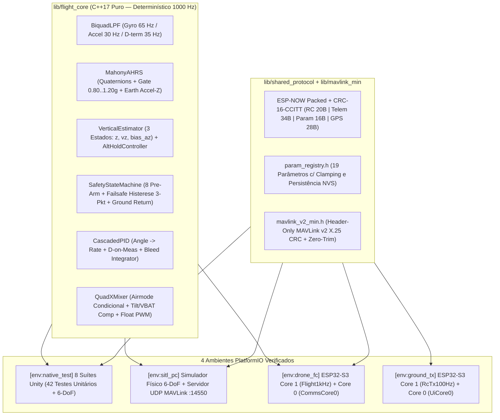
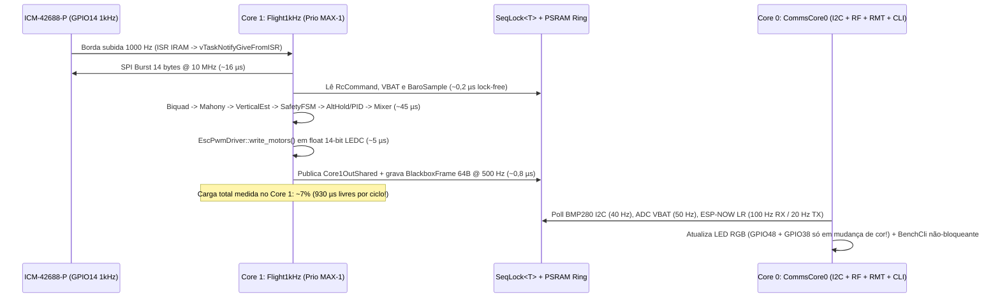

# Especificação Mestre de Arquitetura e Engenharia de Software v2.1 — Quadricóptero 450 mm ESP32-S3

Este documento é a **referência técnica definitiva de engenharia de software e controle** do projeto **ESP32-S3 Quad-450**. Ele documenta a arquitetura em camadas (*Clean Embedded*), o modelo real de tempo real Dual-Core no FreeRTOS do ESP32-S3, as convenções aeronáuticas `FRD`/`NED`, as equações discretas e margens de estabilidade de Bode, as proteções contra casos de borda físicos, o protocolo aéreo binário `ESP-NOW LR 250 kbps`, a ponte `MAVLink v2` (`19` parâmetros) e a suíte de verificação (`42` testes automatizados + SITL 6-DoF).

---

## 1. Arquitetura Hexagonal (*Clean Embedded* — Zero Acoplamento de Hardware no Core)

A regra arquitetural central do monorepo é: **`lib/flight_core` é C++17 puro e determinístico** (zero `malloc`/`new`, zero `Arduino.h`, zero mutexes), permitindo que **exatamente o mesmo binário matemático de controle** execute em 4 alvos de compilação:



---

## 2. Árvore Real do Repositório (`v2.1`)

```text
esp32s3-quad450/
├── platformio.ini                      # 4 ambientes: native_test, sitl_pc, drone_fc, ground_tx
├── lib/
│   ├── flight_core/                    # Núcleo matemático C++17 independente de plataforma
│   │   ├── include/
│   │   │   ├── fc_types.h              # Vec3f, Quaternion, EulerAngles FRD, SystemState, PreArmFlags
│   │   │   ├── imu_orientation.h       # Matriz ortogonal 0°/90°/180°/270° p/ montagem na placa 7x9
│   │   │   ├── biquad_lpf.h            # Butterworth 2ª ordem Direct Form II Transposed + NaN guard
│   │   │   ├── mahony_ahrs.h           # Fusão 6-DoF Quaternions + Gyrobias + Earth Accel-Z
│   │   │   ├── alt_estimator.h         # Estimador Vertical 3-estados + AltHold/Flare/Touchdown
│   │   │   ├── pid_cascade.h           # CascadedPID + D-on-Measurement + Bleed Anti-Windup
│   │   │   ├── quad_mixer.h            # Mixer Quad-X + Supressão Airmode em Pouso + Float PWM
│   │   │   ├── safety_fsm.h            # Pre-Arm, Failsafe 2 estágios (3-pkt recovery) e >65° Flip
│   │   │   ├── gimbal_mapper.h         # Calibração NVS min/mid/max, deadband e Expo cúbico
│   │   │   ├── nav_interface.h         # Contrato plugável p/ Fase 2 (u-blox M10 + QMC5883L)
│   │   │   └── flight_pipeline.h       # Orquestrador determinístico FlightPipeline::step_1khz()
│   │   └── src/ ...
│   ├── shared_protocol/                # Protocolo binário ESP-NOW + Tabela de 19 Parâmetros
│   │   └── include/
│   │       ├── radio_packets.h         # RcCommandPkt(20B), TelemFastPkt(34B), ParamSyncPkt(16B), GpsNavPkt(28B)
│   │       └── param_registry.h        # 19 parâmetros MAVLink com limites min/max validados
│   ├── mavlink_min/                    # Implementação enxuta MAVLink v2 compatível com QGroundControl
│   │   └── include/mavlink_v2_min.h    # HEARTBEAT, SYS_STATUS, ATTITUDE, VFR_HUD, PARAM_*, COMMAND_LONG
│   ├── hal_sync/
│   │   └── include/seqlock.h           # SeqLock<T> atômico C++17 (zero bloqueio Core 0 <-> Core 1)
│   ├── hal_esp32s3/                    # Drivers de hardware dedicados ESP32-S3 (Arduino-ESP32 3.x / IDF 5.x)
│   │   ├── include/ & src/
│   │   │   ├── drv_icm42688_spi.*      # SPI FSPI 10 MHz + INT1 1 kHz (ICM-42688-P + backup ICM-42605/MPU-6500)
│   │   │   ├── drv_bmp280_i2c.*        # I2C 400 kHz c/ compensação Bosch 64-bit e tara automática
│   │   │   ├── drv_esc_pwm.*           # LEDC 14-bit @ 400 Hz em float (6.553 níveis = 0,1526 µs/passo)
│   │   │   ├── drv_espnow_lr.*         # WIFI_PROTOCOL_LR puro + WIFI_PHY_RATE_LORA_250K + RSSI por MAC
│   │   │   ├── blackbox_psram.*        # Ring-buffer de 6,5 MB (106.496 quadros @ 500 Hz) na Octal PSRAM
│   │   │   └── bench_cli.*             # Console interativo p/ Portões 5 a 8 + trava NVS armado
│   └── sim_physics/                    # Planta física 6-DoF do Quad-450 (900 g, A2212, sag 3S, vibração)
├── src/
│   ├── drone_fc/main.cpp               # Core 1: Flight1kHz (Prio 24) | Core 0: CommsCore0 (I2C/RF/LED/CLI)
│   ├── ground_tx/                      # Core 1: RcTx100Hz (ADC1 unificado) | Core 0: UiCore0 (OLED/MAVLink)
│   └── sitl_pc/main_sitl.cpp           # Servidor SITL tempo real + modo --headless-demo
├── test/                               # 8 suítes (42 casos de teste automatizados)
└── tools/
    ├── verify_sitl_mavlink.py          # Teste E2E pymavlink contra o binário sitl_pc
    └── analyze_blackbox.py             # Analisador de FFT, rastreamento PID e histograma de jitter dt_us
```

---

## 3. Convenção Estrita `FRD` / `NED` e Matriz Canônica do Mixer `Quad-X`

Todo o pipeline adota estritamente **FRD (*Forward-Right-Down*)** no corpo e **NED (*North-East-Down*)** na Terra:
- **$+X$ (`Roll`, $\phi, p$):** Frente; positivo = **Asa Direita desce**.
- **$+Y$ (`Pitch`, $\theta, q$):** Direita; positivo = **Nariz sobe**.
- **$+Z$ (`Yaw`, $\psi, r$):** Baixo; positivo = **Nariz gira no sentido horário** (visto de cima).

Para comandos de momento normalizados $(u_{\text{roll}}, u_{\text{pitch}}, u_{\text{yaw}})$:
$$
\begin{aligned}
m_1 \text{ (Frente-Direita, CCW }\circlearrowleft\text{)} &= u_{\text{thr}} - u_{\text{roll}} + u_{\text{pitch}} + u_{\text{yaw}} \\
m_2 \text{ (Traseira-Direita, CW }\circlearrowright\text{)} &= u_{\text{thr}} - u_{\text{roll}} - u_{\text{pitch}} - u_{\text{yaw}} \\
m_3 \text{ (Traseira-Esquerda, CCW }\circlearrowleft\text{)} &= u_{\text{thr}} + u_{\text{roll}} - u_{\text{pitch}} + u_{\text{yaw}} \\
m_4 \text{ (Frente-Esquerda, CW }\circlearrowright\text{)} &= u_{\text{thr}} + u_{\text{roll}} + u_{\text{pitch}} - u_{\text{yaw}}
\end{aligned}
$$

---

## 4. Isolamento Real Dual-Core no ESP32-S3 (`v2.1`)

> [!IMPORTANT]
> No `Arduino-ESP32 3.x` (`sdkconfig.h`), `CONFIG_ARDUINO_RUNNING_CORE = 1` — ou seja, `setup()` e `loop()` executam no **Core 1**! Além disso, o driver `esp32-hal-i2c` aloca a interrupção de hardware do barramento `Wire` na CPU que invoca `Wire.begin()`.
> Por isso, na arquitetura **v2.1**, `loop()` permanece adormecida (`vTaskDelay(1000 ms)`) e toda a carga de I2C, RMT, Wi-Fi/ESP-NOW e USB-CDC roda dentro de tasks explicitamente fixadas no **Core 0** (`CommsCore0` no drone e `UiCore0` no controle), garantindo **zero interrupções de I2C ou RMT sobre o Core 1**!



**Proteções Adicionais de Tempo Real (`v2.1`):**
1. **Bloqueio Estrito de Escrita `NVS` Armado:** `save_nvs_settings()` verifica `motors.armed == false` antes de tocar na Flash SPI, eliminando o risco de suspensão de cache `XIP` (`25–60 ms`) em voo.
2. **USB-CDC `HWCDC` Não-Bloqueante:** `Serial.setTxTimeoutMs(0)` no `ground_tx` (e `10 ms` no `drone_fc`) impede travamentos de `2.000 ms` quando alimentado por powerbank ou porta USB sem terminal aberto, combinado com envio cadenciado de `PARAM_VALUE` (`2` pacotes/tick = `74 B`) para nunca saturar o FIFO USB.
3. **Unificação do `ADC1` no `ground_tx`:** Todas as leituras analógicas (4 gimbals @ `100 Hz` 16× oversampled + bateria `18650` @ `10 Hz` 4× oversampled) ocorrem sequencialmente na mesma task `RcTx100Hz`, eliminando contenção concorrente no SAR `ADC1`.

---

## 5. Dinâmica de Controle, Margens de Estabilidade e Casos de Borda (`v2.1`)

### 5.1 Resposta em Frequência e Margens de Estabilidade (Planta 450 mm, $I_{xx} = 0,0105\text{ kg}\cdot\text{m}^2$, $\tau_m = 35\text{ ms}$)
Com os filtros e ganhos padrão da revisão **v2.1**:
- `GYRO_LPF_HZ = 65,0 Hz` (`Biquad` 2ª ordem Butterworth) e `DTERM_LPF_HZ = 35,0 Hz`
- `RATE_RP_KP = 0,14`, `RATE_RP_KI = 0,18`, `RATE_RP_KD = 0,0045`, `ANG_KP = 4,50`
- **Frequência de Cruzamento de Ganho (Malha de Taxa):** $f_c = \mathbf{4,18\text{ Hz}}$
- **Margem de Fase (`PM`):** **`54,2°`** *(alvo aeroespacial $\ge 45^\circ$)*
- **Margem de Ganho (`GM`):** **`14,3 dB`** *(alvo $\ge 6\text{ dB}$)*
- **Rejeição da Vibração de Passagem de Pás em Hover (`2× BPF ≈ 142 Hz`):** **`-26,7 dB`** no giroscópio!

### 5.2 Três Proteções Críticas de Casos de Borda Físicos (`v2.1`)
1. **Anti-Capotagem / Anti-*Bounce* em Pouso sobre Rampa Inclinada (`P0-CTRL-1`):**
   - Em pousos manuais com acelerador zerado (`throttle <= idle + 2%`) ou durante o descarregamento de empuxo no toque de *Failsafe* (`effective_throttle <= 0,90 * hover_thr`), `FlightPipeline` desativa o deslocamento ascendente do *Airmode* (`allow_airmode = false`, limitando o diferencial máximo e impedindo que os motores disparem a `100%` tentando nivelar o chão inclinado!), drena exponencialmente o integrador `I` (`bleed_integration`, $\tau \approx 125\text{ ms}$) e transita `FLYING → ARMED_IDLE` após `1,0 s` com chassi quieto.
2. **Transição *Bumpless* se o Barômetro `BMP280` Falhar em Voo (`P0-CTRL-2`):**
   - Em `ALT_HOLD`, o piloto mantém o stick centralizado em `50%`, enquanto o drone de `3,4:1` empuxo/peso paira em `~29%–36%`. Se o `BMP280` parar de atualizar (`> 250 ms`), o sistema cai para `STABILIZE` remapeando continuamente a banda central `[45%..55%]` do stick para `learned_hover_throttle()`, evitando qualquer disparo brusco de subida!
3. **Histerese de Recuperação de Rádio vs. Corte Instantâneo:**
   - Sair de `FAILSAFE_DESCEND → FLYING` exige **3 pacotes RC válidos consecutivos** com intervalo `<= 150 ms` (evitando solavancos de acelerador por pacotes fantasmas na borda do alcance de `1 km`), mas **1 único pacote com `arm_switch == false` desarma os motores no ato**!

---

## 6. Protocolo Aéreo `ESP-NOW LR` (`250 kbps`) e Tabela dos 19 Parâmetros MAVLink

### 6.1 Estruturas Binárias Compactas (`#pragma pack(push, 1)`, `CRC-16-CCITT`)
Operando em `WIFI_PROTOCOL_LR` puro com taxa de *peer* explícita `WIFI_PHY_RATE_LORA_250K` (`19,5 dBm`, Canal 1):

| Pacote (`radio_packets.h`) | Tipo | Direção & Taxa | Bytes Exatos | Conteúdo |
| :--- | :-: | :---: | :-: | :--- |
| **`RcCommandPkt`** | `0xA1` | `TX → Drone` @ `100 Hz` | **`20 B`** | `magic`, `type`, `seq`, `thr/roll/pitch/yaw_permil`, `arm_magic`, `flight_mode`, `aux_flags`, `crc16` |
| **`TelemFastPkt`** | `0xB1` | `Drone → TX` @ `20 Hz` | **`34 B`** | `state`, `flight_mode`, `prearm_flags`, `roll/pitch/yaw_deg10`, `alt_cm`, `vz_cms`, `vbat_mv`, `motor_pct[4]`, `drone_rssi_dbm`, `cpu_load_pct`, `loop_dt_us`, `ack_seq`, `crc16` |
| **`ParamSyncPkt`** | `0xC1` | Bidirecional c/ ACK/Retry | **`16 B`** | `req_id`, `op` (`GET`/`SET`/`ACK`/`SAVE_NVS`), `param_idx`, `status`, `value(float)`, `crc16` |
| **`GpsNavPkt`** | `0xD1` | Reservado Fase 2 (`5 Hz`) | **`28 B`** | `lat_e7`, `lon_e7`, `home_dist_dm`, `ground_speed_cms`, `heading_cdeg`, `sats`, `fix_type`, `hdop_10`, `nav_state`, `crc16` |

### 6.2 Os 19 Parâmetros Ajustáveis em Voo (`QGroundControl` / `BenchCli` / `NVS`)
Ao estabelecer link com o drone, `MavlinkUsbBridge` puxa automaticamente os **19 parâmetros** reais gravados na `NVS` do `drone_fc` e aceita gravação remota via `MAV_CMD_PREFLIGHT_STORAGE` ou segurando `[AUX]` por `1,5 s` (desarmado):

| Índice | Nome MAVLink (`16 chars`) | Valor Padrão `v2.1` | Faixa Permitida | Função |
| :-: | :--- | :---: | :---: | :--- |
| `0` | `GYRO_LPF_HZ` | **`65.0`** | `20 .. 250` | Corte Butterworth 2ª ordem do giroscópio (Hz) |
| `1` | `ACCEL_LPF_HZ` | **`30.0`** | `5 .. 100` | Corte Butterworth 2ª ordem do acelerômetro (Hz) |
| `2` | `DTERM_LPF_HZ` | **`35.0`** | `15 .. 120` | Corte Butterworth 2ª ordem do termo D (Hz) |
| `3` | `MAHONY_KP` | **`2.00`** | `0.20 .. 10.0` | Ganho proporcional de gravidade do AHRS |
| `4` | `MAHONY_KI` | **`0.05`** | `0.00 .. 0.50` | Ganho integral de bias residual do AHRS |
| `5` | `ANG_KP` | **`4.50`** | `1.00 .. 10.0` | Ganho da malha externa de Ângulo (`rad → rad/s`) |
| `6` | `MAX_TILT_DEG` | **`35.0`** | `15.0 .. 55.0` | Inclinação máxima em `STAB` / `ALTH` (`CINE` limita a `20°`) |
| `7` | `RATE_RP_KP` | **`0.14`** | `0.02 .. 0.60` | Ganho P de taxa Roll/Pitch |
| `8` | `RATE_RP_KI` | **`0.18`** | `0.00 .. 0.80` | Ganho I de taxa Roll/Pitch |
| `9` | `RATE_RP_KD` | **`0.0045`** | `0.00 .. 0.03` | Ganho D (*D-on-Measurement*) Roll/Pitch |
| `10` | `RATE_YAW_KP` | **`0.25`** | `0.05 .. 0.80` | Ganho P de taxa Yaw |
| `11` | `RATE_YAW_KI` | **`0.15`** | `0.00 .. 0.60` | Ganho I de taxa Yaw |
| `12` | `MOTOR_IDLE` | **`0.07`** | `0.04 .. 0.15` | Rotação mínima armado (`7% = 1070 µs`) |
| `13` | `VBAT_NOMINAL` | **`11.1`** | `10.0 .. 12.6` | Tensão de referência p/ compensação de sag 3S (V) |
| `14` | `FS_HOVER_THR` | **`0.36`** | `0.20 .. 0.60` | Semente inicial de acelerador de *hover* / Failsafe |
| `15` | `ALT_HOLD_KP` | **`1.15`** | `0.30 .. 3.00` | Ganho P de posição de altitude (`m → m/s`) |
| `16` | `VEL_Z_KP` | **`0.22`** | `0.05 .. 0.60` | Ganho P de velocidade vertical $v_z$ |
| `17` | `VEL_Z_KI` | **`0.14`** | `0.02 .. 0.40` | Ganho I vertical (aprende o *hover* real da bateria!) |
| `18` | `VEL_Z_KD` | **`0.05`** | `0.00 .. 0.20` | Amortecimento D sobre aceleração vertical limpa $a_{z,\text{up}}$ |

---

## 7. Suíte Completa de Verificação Automatizada (`42` Testes + SITL + FFT)

| Alvo / Ferramenta | Comando | O que Valida Matematicamente |
| :--- | :--- | :--- |
| **8 Suítes Nativas (`42` casos)** | `pio test -e native_test` | Filtros Biquad, Quaternions Mahony (puxada 2G, NaN, alinhamento em rampa), 4 rotações da IMU, 6 direções `Quad-X`, anti-windup, histerese de 3 pacotes vs Kill-Switch de 1 pacote, pouso inclinado `+8°` sem *runaway*, perda do `BMP280` em voo sem disparo vertical, `ALT_HOLD` + `CINE` com sag de bateria e pouso completo de Failsafe. |
| **Simulador Físico `sitl_pc`** | `pio run -e sitl_pc && ./.pio/build/sitl_pc/program --headless-demo` | Missão 6-DoF de `16 s`: calibração, subida em `ALT_HOLD`, trava de altura, perda de rádio, descida controlada, *flare* e corte automático ao tocar o solo. |
| **Integração `pymavlink`** | `python3 tools/verify_sitl_mavlink.py` | Handshake real MAVLink v2 UDP, leitura dos `19` parâmetros, `PARAM_SET` ao vivo e `COMMAND_LONG`. |
| **Analisador FFT Blackbox** | `python3 tools/analyze_blackbox.py --self-test` | Decodificação binária `BBOX` + `CRC-16`, FFT de ruído de `120 Hz` e métricas de jitter `dt_us`. |
| **Cross-Compilação ESP32-S3** | `pio run -e drone_fc -e ground_tx` | Compilação limpa `Release` p/ `ESP32-S3` (`Arduino 3.3.12 / ESP-IDF 5.x`, `< 16%` RAM, `< 29%` Flash). |
