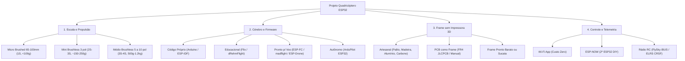

# Pesquisa Exploratória Inicial: Caminhos para um Quadricóptero DIY com ESP32 (Sem Impressora 3D)

> [!NOTE]
> **Documento Histórico da Fase 0 (Brainstorming e Comparação de Caminhos):** Este arquivo registra o levantamento amplo inicial que comparou micro-drones *brushed* vs. 450 mm *brushless* e firmwares prontos vs. código próprio.
> **Para comprar peças, montar o hardware e operar o código fechado do projeto (Revisão Unificada `v2.1`), utilize os documentos oficiais:**
> 1. [**Validação de Engenharia Multidisciplinar, FMEA & BOM Definitiva v2.1**](validacao_engenharia_e_bom_otimizada.md)
> 2. [**Manual de Montagem Milimétrico Passo a Passo v2.1 (Portões 1 a 8)**](manual_montagem_detalhado_450.md)
> 3. [**Especificação Mestre de Arquitetura de Software v2.1**](arquitetura_software_esp32s3.md) & [**Visão Geral do Sistema v2.1**](arquitetura_drone_esp32s3_450.md)

Este documento reúne um panorama amplo de **arquiteturas de software, combinações de hardware, estratégias de estrutura sem impressora 3D, projetos open-source de referência e ideias alternativas** para construir um drone de 4 hélices econômico baseado em ESP32.

---

## 1. Mapa Geral das Decisões

Antes de escolher peças, existem **quatro eixos principais** que moldam completamente o projeto, o custo e a experiência de aprendizado:

---

## 2. Ecossistema de Software: Programar do Zero vs. Firmwares Prontos vs. ArduPilot

Hoje o ecossistema ESP32 para drones está muito mais maduro do que há alguns anos. Você não está limitado apenas a "escrever tudo no braço" ou "tentar portar ArduPilot" — existem **6 caminhos distintos**:

| Caminho / Firmware | Base / Linguagem | Status no ESP32 | Motores Suportados | Configurador / Ground Station | Perfil Ideal |
| :--- | :--- | :--- | :--- | :--- | :--- |
| **Código Próprio (do zero)** | Arduino / C++ / ESP-IDF | Total controle | Brushed (PWM) ou Brushless (PWM/OneShot) | Serial / Web / Próprio | Máximo aprendizado em controle PID, filtros e RTOS |
| **Flix** (`okalachev/flix`) | Arduino / C++ | Estável e didático | Brushed e Brushless | MAVLink (QGroundControl), CLI Wi-Fi, **Simulador incluso** | Aprender teoria de controle sem reinventar toda a base |
| **dRehmFlight (ports ESP32)** | Arduino (arquivo único legível) | Portes da comunidade (ESP32 / S3) | Brushless (PWM/OneShot) | Código-fonte direto | Prototipagem rápida e leitura simples do loop PID |
| **ESP-FC** (`rtlopez/esp-fc`) | C++ / PlatformIO | Muito ativo (ESP32 / S3) | Brushed, PWM, Oneshot, **DShot150/300/600 bidirecional** | **Betaflight Configurator** (interface gráfica completa + Blackbox!) | Melhor desempenho de voo estabilizado/acrobático no ESP32 |
| **madflight** (`qqqlab/madflight`) | Arduino / PlatformIO | Muito ativo (ESP32 / S3 / RP2040 / STM32) | Brushed, PWM, DShot | CLI / Código modular / MAVLink | Montar uma FC modular de < US\$ 10 com peças avulsas |
| **ESP-Drone** (`espressif/esp-drone`) | ESP-IDF (port do **Crazyflie**) | Oficial Espressif (ESP32 / S2 / S3) | Brushed (principal) / adaptável Brushless | App Android/iOS Wi-Fi, `cfclient` Python, ESP-NOW | Micro drones indoor, hover com fluxo óptico/ToF, educação |
| **ArduPilot** (`AP_HAL_ESP32`) | C++ / ESP-IDF / `waf` | **Experimental** (ESP32 e ESP32-S3) | **Apenas PWM padrão** (sem DShot nativo ainda) | Mission Planner / QGroundControl (USB ou Wi-Fi) | Missões autônomas com GPS, waypoints, RTL em drones maiores |

### Detalhes importantes sobre os dois extremos que você citou

#### A) Programar o próprio controlador (do zero ou com base didática)
- **O que você realmente precisa implementar para um drone voar estável:**
  1. **Leitura rápida da IMU (250 Hz a 1 kHz):** ler giroscópio + acelerômetro via SPI (preferível) ou I2C (400 kHz).
  2. **Estimação de atitude (AHRS):** filtro complementar (simples e já voa!), filtro de **Madgwick** ou **Mahony** para converter aceleração + giro em ângulos (*roll*, *pitch*, *yaw*).
  3. **Malha de Controle PID (preferencialmente em cascata):**
     - *Malha externa (Ângulo / Stabilize):* transforma o erro de inclinação desejado em velocidade angular desejada (°/s).
     - *Malha interna (Taxa / Rate):* compara a velocidade angular desejada com o giroscópio e gera a correção.
  4. **Mixer de 4 motores (configuração X):** soma/subtrai *throttle*, *pitch*, *roll* e *yaw* para cada motor e limita entre mínimo e máximo.
  5. **Failsafe de segurança:** se perder sinal de rádio por > 500 ms ou inclinar demais, cortar motores imediatamente.
- **Dica de arquitetura no ESP32 (Dual Core):** no ESP32 clássico e ESP32-S3, use o **Core 1 exclusivamente para o loop de voo em tempo real** (IMU → Filtro → PID → Motores, sem `delay()` e sem `Serial.print()` pesado) e deixe o **Core 0 para Wi-Fi / ESP-NOW / Telemetria**. Isso evita travamentos (*jitter*) causados pela pilha Wi-Fi da Espressif.
- **Excelentes referências para estudar código real:**
  - *Carbon Aeronautics* (série didática passo a passo de controlador de voo em Arduino/Teensy, amplamente portada para ESP32).
  - *Joop Brokking (YMFC)* (clássico da internet sobre PID e mixer de quadricóptero).
  - *Flix (`okalachev/flix`)* (código limpo, moderno, feito especificamente para ESP32, inclusive com simulador para testar seu PID antes de montar o hardware).

#### B) Usar ArduPilot no ESP32 / ESP32-S3 — A Realidade Prática
> [!WARNING]
> O suporte do **ArduPilot para ESP32 é oficial no repositório, mas classificado como experimental**. Nenhum fabricante produz uma FC comercial ArduPilot com ESP32, e existem limitações importantes que você deve conhecer antes de apostar nisso.

- **O que funciona bem:** pessoas já voaram quadricópteros de 450 mm completos com ESP32/ESP32-S3, conectando ao *Mission Planner* por Wi-Fi, com GPS por UART, barômetro e modos estabilizado/Loiter.
- **Os pontos de atrito:**
  1. **Compilação manual obrigatória:** você precisará compilar o firmware em ambiente Linux (ou WSL no Windows) usando ESP-IDF e `waf`, escolhendo ou adaptando um header de definição de placa (`esp32buzz`, `esp32diy`, `esp32s3empty`).
  2. **Apenas PWM padrão para ESCs:** o port ESP32 ainda não traz suporte maduro a DShot (há *feature requests* abertas em 2026), então funciona bem com ESCs PWM clássicos (tipo 30A SimonK/BLHeli em modo PWM), mas não aproveita recursos modernos como telemetria bidirecional RPM.
  3. **Memória e sensores exigidos:** o ArduPilot é pesado (EKF3, MAVLink, logging). Recomenda-se **ESP32-S3 com PSRAM (ex.: N16R8)** ou ESP32 clássico com cuidados de pinagem, além de **IMU por SPI** (ex.: MPU9250 / ICM-20948 / ICM-42688-P) + barômetro (BMP280/MS5611) + cartão SD para logs.
  4. **Alternativa pragmática:** se o objetivo principal for **voo autônomo com ArduPilot sem depurar HAL experimental**, existe a opção de usar uma FC barata STM32 F405 (~R\$ 120–180) rodando ArduPilot estável + **ESP32 como módulo de telemetria Wi-Fi/ESP-NOW (DroneBridge)** ou computador de bordo. Porém, se o objetivo for o desafio de fazer **tudo no ESP32**, `esp-fc` (voo manual/estabilizado) e `ArduPilot ESP32` (autônomo) são ambos viáveis!

---

## 3. Qual Variante de ESP32 Escolher?

Nem todo ESP32 serve igualmente bem para drone. Veja o comparativo:

| Placa / Chip | Núcleos / Clock | Peso aprox. | USB Nativo | PSRAM | Pontos Fortes para Drone | Limitações |
| :--- | :--- | :--- | :--- | :--- | :--- | :--- |
| **ESP32-S3 SuperMini / Zero / XIAO ESP32-S3** | Dual-Core Xtensa LX7, 240 MHz | **2–4 g** | Sim (USB-C) | Algumas versões | **Melhor escolha geral!** Ultraleve, dual-core, suportado por ESP-FC, madflight, ESP-Drone e ArduPilot; XIAO tem carregador LiPo 1S embutido | Menos pinos expostos nas versões mini (checar pinagem antes) |
| **ESP32-S3 DevKit (N16R8)** | Dual-Core Xtensa LX7, 240 MHz | ~10–12 g | Sim (2× USB-C) | **8 MB PSRAM / 16 MB Flash** | **Melhor para ArduPilot** e drones médios (250–450 mm); sobra GPIO, UARTs, SPI e RAM | Grande/pesado para micro drones 1S |
| **ESP32 Clássico (WROOM-32 DevKit)** | Dual-Core Xtensa LX6, 240 MHz | ~10 g | Não (chip UART) | Não (na maioria) | Barato (~R\$ 25–35 no Brasil), fácil de achar, Bluetooth Clássico (útil para controle PS4!), bem documentado | Pesado para micro 1S; mais sensível a brownout sem capacitor; 8 canais RMT |
| **ESP32-C3 SuperMini** | Single-Core RISC-V, 160 MHz | ~2–3 g | Sim | Não | Muito barato (~R\$ 15–20) e minúsculo; já houve projetos single-board com ele (*Sprig-C3*) | **Single-core** (Wi-Fi compete com o loop PID!), menos RMT/GPIOs, suporte limitado em firmwares prontos |

> [!TIP]
> Se for comprar do zero hoje, vá de **ESP32-S3** (versão **XIAO / SuperMini** para micro drones, ou **DevKit N16R8** para drones médios/ArduPilot). A diferença de preço para o ESP32 clássico é mínima e o ganho em USB nativo, periféricos e longevidade de suporte é enorme.

---

## 4. Como Construir o Frame SEM Impressora 3D

Não ter impressora 3D **não é um bloqueio** — na verdade, frames impressos em 3D (PLA/PETG) costumam ser pesados, flexíveis e quebradiços em quedas, gerando vibração que atrapalha o giroscópio. Abaixo estão **8 alternativas excelentes** sem impressora 3D:

### Para Drones Micro / Leves (65 mm a 150 mm)
1. **Frame Plástico de Reposição (A forma mais fácil e barata)**
   - Comprar apenas o chassi de reposição de mini drones populares como **Eachine E010 / JJRC H36** (para motores 615), **Beta65/75**, **Kingkong Q100** ou frames genéricos para **motores 8520**.
   - **Custo:** ~R\$ 15 a R\$ 40 (AliExpress/Shopee/ML).
   - **Vantagem:** já vem com os berços exatos para encaixar motores cilíndricos *coreless* e protetores de hélice!
2. **PCB como Frame (Chassi de Fibra de Vidro FR4 feito sob encomenda)**
   - Você desenha a placa em formato de "X" no KiCad (onde as trilhas de energia já vão pelos braços até os motores!) e fabrica na JLCPCB ou PCBWay (5 placas saem ~US\$ 2 + frete/imposto).
   - **Vantagem:** zero fios soltos, super rígido, levíssimo (~8–15 g), elimina a necessidade de frame separado (mesma filosofia do *Crazyflie*, *ESP-FLY* e *LiteWing*).
3. **Palitos de Picolé / Abaixadores de Língua (Madeira)**
   - Dois palitos largos cruzados em "X" (ou sanduíche duplo no centro) com cola cianoacrilato (Super Bonder) + bicarbonato ou epóxi. Os motores 8520 podem ser presos nas pontas com abraçadeiras de nylon (enforca-gato) ou tubo termo-retrátil.
   - **Custo:** praticamente R\$ 0.
   - **Cuidado:** garantir que os 4 braços fiquem no mesmo plano e simétricos (um braço torto dificulta muito o voo).
4. **Varetas de Fibra de Carbono de Pipa (2 mm ou 3 mm) + Placa Central de FR4/Cartão PVC**
   - Duas varetas cruzadas em X presas com linha + Super Bonder ou epóxi a um quadradinho central (placa de fenolite virgem ou cartão plástico rígido).
   - **Vantagem:** absurdamente leve e rígido!

### Para Drones Médios / Brushless (200 mm a 450 mm)
5. **Perfil Quadrado de Alumínio (10×10 mm ou 12×12 mm) + Centro de Compensado/FR4**
   - O clássico absoluto dos drones DIY antes das impressoras 3D existirem!
   - Compra-se 1 metro de tubo quadrado de alumínio fino em loja de material de construção ou serralheria (~R\$ 15–25), corta em 2 barras cruzadas (ou 4 braços) com serrinha manual, fura com furadeira doméstica e prende entre duas chapas centrais (compensado 3–4 mm, acrílico ou placa de circuito virgem FR4) com parafusos M3.
   - **Vantagens:** muito rígido, suporta motores brushless fortes (A2212, 2205), fácil de desentortar ou trocar um braço quebrado em 10 minutos por centavos.
6. **Sarrafo de Madeira (Pinus / Balsa reforçada / Bambu)**
   - Braços de sarrafo quadrado ~10×10 mm ou 12×12 mm. A madeira tem uma propriedade ótima: **amortece vibrações de alta frequência** melhor que o alumínio, ajudando o giroscópio!
   - **Desvantagem:** quebra com mais facilidade em quedas fortes (mas custa centavos para repor).
7. **Frame Pronto Barato (F450, ZMR250, Toothpick 3" de Carbono)**
   - Um kit **F450** (nylon com fibra de vidro + placa inferior já funcionando como PDB de distribuição de energia) custa ~R\$ 60–110 no Brasil/importação e já resolve toda a mecânica de um drone 450 mm.
   - Um frame **3" estilo Toothpick** ou **5" ZMR250 / TBS Source One V5** em fibra de carbono sai entre R\$ 50 e R\$ 150.
8. **Canibalização de Drone Brinquedo Quebrado / Barato**
   - Comprar um mini-drone barato usado/com placa queimada (tipo Syma X5, E88, H36) por R\$ 30–60. Você ganha de brinde: **frame, 4 motores, engrenagens/hélices CW e CCW e às vezes até a bateria 1S e carregador USB** — basta arrancar a plaquinha original e colocar seu ESP32!

### Resumo Comparativo de Materiais de Frame

| Material / Estratégia | Custo | Peso | Rigidez | Amortecimento de Vibração | Ferramentas Necessárias |
| :--- | :---: | :---: | :---: | :---: | :--- |
| Palito de picolé / madeira fina | Muito baixo | Baixo | Média | Bom | Estilete, cola, abraçadeiras |
| Frame micro pronto (E010 / 8520) | Baixo | Muito baixo | Boa | Bom | Nenhuma |
| PCB como Frame (JLCPCB) | Baixo-Médio | Muito baixo | Excelente | Médio | KiCad (design) + solda |
| Varetas de carbono (pipa) | Baixo | Muito baixo | Excelente | Médio | Serrinha fina, epóxi, abraçadeiras |
| Alumínio 10×10 mm + compensado | Baixo | Médio | Excelente | Baixo (usar espuma na IMU!) | Serrinha, furadeira, parafusos M3 |
| Madeira 10×10 mm / Bambu | Muito baixo | Baixo-Médio | Boa | Muito bom | Serrinha, furadeira, parafusos |
| Kit F450 / ZMR250 pronto | Médio | Médio | Muito boa | Bom | Chave Allen / Philips |

---

## 5. Cinco "Receitas" (Arquiteturas Completas de Peças)

Abaixo estão **5 combinações completas** indo do ultra-barato seguro para voar no quarto até um quadricóptero grande capaz de carregar GPS e rodar ArduPilot. Os preços são estimativas aproximadas de mercado (AliExpress/Shopee/Mercado Livre no Brasil, variando conforme frete e impostos).

### Receita 1: Micro Brushed "Laboratório de Bancada" (Ultra-Barato, ~65–100 mm)
*A porta de entrada mais barata e segura para programar seu próprio controlador ou testar ESP-FC / ESP-Drone.*

- **MCU:** XIAO ESP32-S3 ou ESP32-S3 SuperMini (~R\$ 30–50)
- **IMU:** MPU-6050 (GY-521, ~R\$ 12–20) ou BMI270 / ICM-42688-P (~R\$ 25–45)
- **Motores:** 4× Coreless Brushed **8520** (8,5×20 mm, 3,7 V, 2 CW + 2 CCW, ~50.000 RPM) + hélices 55 mm (~R\$ 35–60 o kit com 4)
  - *Alternativa menor:* 4× motores **720** ou **615** (mais leves, menos empuxo — requer peso total < 40–50 g!)
- **Drivers de Motor (4×):** 4× MOSFET canal-N *logic-level* **SI2302** ou **AO3400** (SMD, baixa tensão de disparo $V_{GS(th)}$ para 3,3 V!) + 4× diodos Schottky *flyback* **1N5819 / SS14** + 4× resistores pull-down 10 kΩ (~R\$ 15 total)
- **Bateria:** LiPo **1S 3,7 V 500–650 mAh 25C–40C** + carregador USB 1S (~R\$ 35–60)
- **Frame:** Palitos de picolé, varetas de carbono, frame pronto para 8520 ou PCB custom (~R\$ 0–35)
- **Controle:** Celular via Wi-Fi (R\$ 0) ou 2º ESP32 com joysticks via **ESP-NOW** (+R\$ 45)
- **Estimativa total:** **~R\$ 130 a R\$ 240**
- **Peso alvo:** < 70–85 g (cada motor 8520 gera ~35–45 g de empuxo máximo → empuxo total ~140–180 g → relação empuxo/peso $\ge 2:1$).
- **Prós:** barata, segura para testar dentro de casa sem cortar ninguém, não precisa de ESCs caros.
- **Contras:** motores *brushed* desgastam as escovas em ~5–10 horas de voo; exige atenção rigorosa ao peso total e à queda de tensão (*brownout*) na bateria 1S; voa mal com vento.

---

### Receita 2: Hack / Canibalização de Drone Brinquedo (Zero Mecânica)
*Ideal se você quer focar 100% em eletrônica e software sem gastar tempo fazendo frame ou alinhando motores.*

- **Base mecânica:** Comprar um mini-drone barato ou com defeito na placa (ex.: Eachine E010/E011, JJRC H36, Syma X5C usado, clones E88) (~R\$ 40–90).
- **O que você aproveita:** frame completo com proteção de hélice, 4 motores com engrenagens/hélices balanceadas, bateria 1S e carregador USB.
- **O que você substitui:** remove a placa original e monta em cima um **ESP32-S3 SuperMini** + **MPU6050/BMI270** + mini placa perfurada (ou PCB) com 4× MOSFETs AO3400 + diodos Schottky.
- **Estimativa total:** **~R\$ 110 a R\$ 190**
- **Prós:** geometria garantida de fábrica, já vem com protetores de hélice para sobreviver a 100 quedas durante o ajuste de PID.
- **Contras:** atenção ao peso (o ESP32 + breakout precisa pesar perto do que a placa original pesava — prefira drones do porte do Syma X5 ou com motores 8520, que têm folga de empuxo).

---

### Receita 3: Mini Brushless "Toothpick" 3 Polegadas (Melhor Custo-Benefício Durável)
*O salto de qualidade: motores sem escova (não desgastam), voa muito bem ao ar livre, ágil e resistente, ainda leve e econômico.*

- **MCU:** ESP32-S3 SuperMini ou XIAO ESP32-S3 (~R\$ 35–50)
- **IMU:** **ICM-42688-P** ou **BMI270** via SPI (~R\$ 30–50) — muito menos ruído que o MPU6050!
- **Motores:** 4× Brushless **1103 / 1204 / 1404** (ex.: 4500–6500 KV para 2S–3S) (~R\$ 140–220 o kit de 4)
- **ESCs:** 1× **ESC 4-em-1 de 15A–20A** (BLHeli_S / Bluejay, suporta PWM e DShot!) (~R\$ 100–160) — já simplifica toda a fiação!
- **Regulador (BEC):** Mini módulo step-down 5 V 2A (caso o ESC 4-em-1 não tenha BEC 5 V integrado) (~R\$ 10)
- **Hélices:** 3 polegadas bipá ou tripá (ex.: 3018 / 3025) (~R\$ 20)
- **Frame:** Frame 3" de carbono pronto (~R\$ 50–80) ou feito com varetas/chapas finas
- **Bateria:** LiPo **2S ou 3S 450–650 mAh** (~R\$ 70–100) + carregador balanceador simples (ex.: B3/B6 ~R\$ 50–120)
- **Firmware recomendado:** **ESP-FC** (com Betaflight Configurator + DShot!), **madflight** ou código próprio.
- **Estimativa total (sem rádio/carregador):** **~R\$ 450 a R\$ 680**
- **Prós:** motor brushless dura anos, excelente relação empuxo/peso, seguro o suficiente para voar em parques abertos, suporta DShot no ESP-FC.
- **Contras:** mais caro que brushed; precisa de carregador balanceador de LiPo 2S/3S.

---

### Receita 4: Clássico 450 mm "Trator Educacional / ArduPilot" (9–10 Polegadas)
*A plataforma padrão mundial de universidades e projetos ArduPilot: espaçosa, fácil de montar e soldar, aceita GPS, sensores extras e payload.*

- **MCU:** **ESP32-S3 DevKit N16R8** (com PSRAM) ou ESP32 clássico DevKit (~R\$ 45–65)
- **Sensores (10-DoF + GPS):**
  - IMU SPI: **ICM-20948** ou **GY-91** (MPU9250 + BMP280) ou **ICM-42688-P + BMP280 + QMC5883L** (~R\$ 40–80)
  - GPS + Bússola externa (opcional na fase 1, essencial para autonomia): **u-blox M8N ou M10** (~R\$ 70–120)
- **Motores:** 4× **A2212 1000KV** (~R\$ 120–180 o kit com 4)
- **ESCs:** 4× **ESC 30A** (SimonK / BLHeli, com BEC 5 V embutido — aceitam PWM padrão do ArduPilot!) (~R\$ 120–180 os 4)
- **Hélices:** 4× **1045** (10×4,5") (~R\$ 25–40)
- **Frame:** **Perfil de alumínio 10×10 mm DIY** (~R\$ 30) **ou** Kit **F450 pronto** com placa PDB (~R\$ 80–110)
- **Bateria:** LiPo **3S 2200 mAh 30C** (~R\$ 130–180) + Carregador **iMAX B6** (~R\$ 120–160)
- **Firmware recomendado:** **ArduPilot (`AP_HAL_ESP32`)**, **madflight** ou **código próprio** (muito espaço para depurar e instalar placa perfurada com headers!).
- **Estimativa total (sem rádio/carregador):** **~R\$ 550 a R\$ 850**
- **Prós:** peças super fáceis de achar no Brasil (kits A2212+ESC30A+F450 existem aos montes); muito espaço físico; consegue carregar GPS, sensores, câmera e rodar ArduPilot; tempo de voo bom (10–15 min).
- **Contras:**
  > [!CAUTION]
  > **Segurança:** hélices de 10 polegadas em motores A2212 têm energia suficiente para causar cortes graves. **Nunca** teste em bancada com hélices instaladas e voe apenas em áreas amplas e abertas!

---

### Receita 5: Quadricóptero 5" Econômico (220–250 mm)
*Meio-termo entre o Toothpick e o 450 mm: estrutura muito resistente a quedas, excelente para aprender voo estabilizado/acrobático com ESP-FC.*

- **MCU:** ESP32-S3 + IMU **ICM-42688-P** ou **BMI270**
- **Motores:** 4× **2204 ou 2205 2300KV** (versões econômicas)
- **ESCs:** 4× ESC 20A–30A ou 1× ESC 4-em-1 30A–35A
- **Hélices:** 5045 (5 polegadas)
- **Frame:** ZMR250 / TBS Source One V5 (~R\$ 90–140) ou alumínio/madeira reforçada
- **Bateria:** LiPo 3S 1300–1500 mAh 45C+
- **Estimativa total (sem rádio/carregador):** **~R\$ 500 a R\$ 800**

---

## 6. Cardápio Modular de Sub-sistemas

### A) Sensores Inerciais (IMU) — O Coração da Estabilização
| Sensor | Barramento | Ruído / Qualidade | Observações Práticas |
| :--- | :---: | :---: | :--- |
| **MPU-6050 (GY-521)** | Apenas I2C | Médio (sensível a vibração) | Barato (~R\$ 12), milhares de tutoriais, ótimo para começar e micro brushed. Evitar em brushless potentes sem bom amortecimento. |
| **MPU-9250 (GY-91)** | SPI e I2C | Médio-Bom (9-DoF + BMP280 no GY-91) | Clássico do Flix e ArduPilot ESP32. **Atenção:** existem muitos módulos falsificados vendidos como MPU9250 que na verdade são MPU6500 sem magnetômetro! |
| **BMI270** | SPI e I2C | Muito Bom (baixo ruído) | Usado em muitas FCs comerciais modernas; ótimo suporte em ESP-FC e madflight. |
| **ICM-42688-P** | SPI e I2C | **Excelente (padrão ouro atual)** | Altíssima taxa de amostragem, baixíssimo ruído e deriva térmica; melhor escolha para quem quer voo impecável em brushless. |
| **ICM-20948** | SPI e I2C | Muito Bom (9-DoF) | Sucessor oficial moderno do MPU-9250 (tem magnetômetro AK09916). |

> [!TIP]
> **Dica de ouro de montagem:** sempre que puder, conecte a IMU ao ESP32 via **SPI** (muito mais rápido e imune a travamentos de barramento que o I2C) e fixe a placa com **fita dupla-face de espuma (3M VHB)** ou borrachinhas (*o-rings*) para filtrar a vibração mecânica dos motores!

### B) Como Controlar o Drone (Rádio / Comunicação)
O transmissor RC costuma ser uma das partes mais caras de um drone — mas com ESP32 você tem ótimos atalhos:

1. **Smartphone via Wi-Fi (Custo: R\$ 0)**
   - Funciona nativamente no **ESP-Drone**, **Flix** e em código próprio (UDP/WebSocket).
   - *Bom para:* primeiros testes, orçamento mínimo, indoor.
   - *Ruim para:* voo preciso (sem tato físico nos dedos) e alcance (20–50 m).
2. **Controle DIY com um 2º ESP32 via ESP-NOW (Custo: ~R\$ 45–70)**
   - Um segundo ESP32 + 2 módulos de joystick analógico (ou *gimbals* retirados de um controle de PS2/Xbox velho) + 2 chaves (Armar / Modo de voo) + bateria 1S.
   - **ESP-NOW** envia pacotes direto de rádio para rádio sem roteador, com **latência baixíssima (< 5 ms)** e alcance de **150 a 400+ metros** em campo aberto!
   - Suportado diretamente por **ESP-FC**, **ESP-Drone** e super fácil de usar em código próprio.
3. **Controle Bluetooth (PS4 / Xbox)**
   - Possível no **ESP32 clássico** (usando bibliotecas como `Bluepad32`) ou via celular fazendo ponte Wi-Fi. Ótima ergonomia sem comprar rádio RC, porém alcance limitado (~15–30 m).
4. **Rádio RC de Entrada — FlySky FS-i6 / FS-i6X + Receptor FS-iA6B (~R\$ 250–350)**
   - Protocolo **iBUS** (1 único fio UART no ESP32, 10–14 canais digitais limpos!). Confiável, alcance > 500 m, funciona em qualquer firmware.
5. **ExpressLRS (ELRS) 2.4 GHz — ex.: RadioMaster Pocket + Receptor EP1/EP2 (~R\$ 380–500)**
   - Padrão moderno de mercado: alcance de quilômetros, latência de milissegundos, protocolo **CRSF** (UART), suportado por **ESP-FC**, **madflight** e **ArduPilot**. Se você planeja continuar no hobby de drones depois deste projeto, é o melhor investimento de longo prazo.

### C) Sensores Extras (Para Evoluir Depois)
- **Barômetro (BMP280 / DPS310 / MS5611):** manutenção de altitude (*Altitude Hold*). Lembrar de colocar um pedacinho de **espuma preta** sobre o chip para bloquear vento das hélices e luz!
- **ToF Laser (VL53L0X / VL53L1X) + Fluxo Óptico (PMW3901 ou módulo combinado MTF-01):** permite voo pairado super estável **dentro de casa sem GPS** (usado no ESP-Drone e ArduPilot!).
- **GPS (u-blox M8N / M10):** posição, retorno automático (*Return to Launch*) e missões autônomas no ArduPilot.
- **Divisor de Tensão no ADC do ESP32:** 2 resistores baratos para monitorar a tensão da bateria e evitar destruir a LiPo por descarga excessiva!

---

## 7. Armadilhas Elétricas e Mecânicas que Derrubam Projetos ESP32

Estas são as 6 falhas mais comuns em drones DIY com ESP32 — conhecer todas desde o início economiza muito dinheiro e frustração:

1. **Brownout (Reset do ESP32 ao acelerar em 1S):**
   - Quando 4 motores *brushed* ligam juntos, a bateria 3,7 V cai momentaneamente para ~3,1 V e o ESP32 reinicia no ar!
   - **Solução:** colocar um capacitor eletrolítico *low-ESR* (470 µF a 1000 µF) na alimentação, usar regulador LDO de baixíssima queda (*low dropout*) ou pequeno conversor *boost/buck-boost* dedicado para o ESP32, e usar bateria 1S com **alta taxa de descarga (mínimo 25C–40C)** — nunca usar célula 18650 comum ou bateria de celular (que têm baixa descarga e proteção que desarma).
2. **MOSFET errado para motores Brushed:**
   - O GPIO do ESP32 entrega **3,3 V**. Transistores bipolares comuns (TIP122, 2N2222) ou MOSFETs comuns (IRF540, IRFZ44N) **não saturam** em 3,3 V — eles esquentam e o motor fica fraco.
   - **Solução:** usar MOSFET canal-N *logic-level* de baixo $R_{DS(on)}$ em 2,5–3,3 V, como **SI2302**, **AO3400** (SMD) ou **IRLZ44N / IRL540** (PTH, mais pesados), **sempre** com diodo Schottky *flyback* (SS14 / 1N5819) em antiparalelo com o motor e resistor de pull-down (10 kΩ) do Gate para o GND (para os motores não dispararem durante o boot do ESP32!).
3. **Conflito de pinos de *strapping* no boot do ESP32:**
   - Pinos como GPIO0, GPIO2, GPIO12, GPIO15 (ESP32 clássico) mudam o modo de boot ou dão pulso rápido ao ligar. Nunca ligue motores diretamente neles sem checar a documentação da sua variante.
4. **Conflito de BEC em 4 ESCs (Brushless):**
   - Se usar 4 ESCs individuais com BEC 5 V interno, ligue o fio vermelho (+5 V) de **apenas UM ESC** no ESP32 (ou use um UBEC dedicado) e isole os outros três fios vermelhos (mantendo todos os GNDs e sinais conectados).
5. **Relação Empuxo/Peso abaixo de 2:1:**
   - Para um quadricóptero ser controlável e conseguir corrigir inclinações sem saturar os motores, o **empuxo máximo somado dos 4 motores deve ser pelo menos 2× o peso total pronto para voo** (com bateria!). Idealmente 2,5:1 a 3:1.
6. **Esquecer o Carregador de LiPo e Segurança da Bateria:**
   - Baterias LiPo 2S/3S exigem carregador balanceador e nunca devem descarregar abaixo de 3,3–3,5 V por célula. Em 1S, carregadores USB baratos funcionam bem.

---

## 8. Projetos Open-Source Semelhantes para Inspiração e Estudo

- **[ESP-FC (`rtlopez/esp-fc`)](https://github.com/rtlopez/esp-fc):** Controlador de voo para ESP32/ESP32-S3 compatível com **Betaflight Configurator**, suporta brushed e brushless (até DShot bidirecional), CRSF/ELRS, iBUS, SBUS e ESP-NOW.
- **[madflight (`qqqlab/madflight`)](https://github.com/qqqlab/madflight):** Biblioteca modular em Arduino/PlatformIO pensada para montar controladores de voo de < US\$ 10 usando placas ESP32/ESP32-S3 + breakouts comuns.
- **[Flix (`okalachev/flix`)](https://github.com/okalachev/flix):** Quadricóptero minimalista com ESP32 feito do zero com foco educacional, código super limpo, MAVLink e simulador incluso.
- **[ESP-Drone (`espressif/esp-drone`)](https://github.com/espressif/esp-drone):** Firmware oficial da Espressif baseado no Crazyflie (ESP-IDF), controle por app Wi-Fi, ESP-NOW e suporte a sensores de altura/posição indoor.
- **[ESP-FLY (`Seeed-Projects/Co-Create_ESP-FLY`)](https://github.com/Seeed-Projects/Co-Create_ESP-FLY):** Micro drone open-source baseado no XIAO ESP32-S3 + PCB customizada, compatível tanto com ESP-Drone quanto com ESP-FC.
- **[LiteWing + ESP-FC (CircuitDigest)](https://circuitdigest.com/tutorial/how-to-connect-the-litewing-esp32-drone-betaflight):** Tutorial detalhado de como configurar um micro drone ESP32-S3 brushed no Betaflight Configurator via ESP-FC.
- **[ArduPilot ESP32 Docs](https://ardupilot.org/dev/docs/esp32-autopilot.html) & [AP_HAL_ESP32](https://github.com/ArduPilot/ardupilot/blob/master/libraries/AP_HAL_ESP32/README.md):** Documentação técnica para compilar e rodar ArduPilot em placas ESP32/ESP32-S3.
- **[dRehmFlight_ESP32](https://github.com/goatboy29/dRehmFlight_ESP32):** Adaptação do famoso controlador didático *dRehmFlight* (originalmente Teensy) para ESP32.
- **[DroneBridge for ESP32](https://ardupilot.org/sub/docs/common-esp32-telemetry.html):** Caso decida usar uma FC STM32 com ArduPilot e o ESP32 como link de telemetria Wi-Fi/ESP-NOW.

---

## 9. Ideias Diferentes / Fora da Caixa para Considerar

Antes de bater o martelo na arquitetura, vale considerar algumas abordagens criativas que aumentam muito a taxa de sucesso:

1. **Estratégia "Escada em 2 Fases" (Software Primeiro, Hardware Seguro):**
   - **Fase 0 (Custo R\$ 0):** Rodar o simulador do **Flix** ou **ArduPilot SITL** no PC para entender PID, modos de voo e telemetria sem quebrar uma única hélice.
   - **Fase 1 (Bancada de Testes 1-Eixo / Gangorra):** Antes do primeiro voo livre, prender o drone numa "gangorra" feita de madeira/cano PVC que permite girar apenas em *Roll* (ou *Pitch*). Assim você testa seu código PID e vê o drone se equilibrar sozinho na mesa com 100% de segurança!
2. **Single-Board Drone (Sua Própria PCB como Frame):**
   - Mesmo sem impressora 3D, projetar uma placa em "X" no KiCad (onde você solda um XIAO ESP32-S3, uma IMU breakout e 4 MOSFETs) gera um drone com acabamento profissional por poucos dólares. É uma aula completa de engenharia eletrônica + mecânica.
3. **Micro Drone "Hover Indoor" com Sensor de Chão (ToF + Optical Flow):**
   - Em vez de focar em acrobacia ou GPS externo, montar um micro drone com ESP32-S3 + VL53L1X (laser de altura) + PMW3901 (fluxo óptico) usando ESP-Drone ou código próprio para pairar sozinho dentro de casa — quase um "mini DJI Tello" open-source.
4. **Arquitetura Híbrida (ESP32-S3-CAM + FC Dedicada):**
   - Se a sua ideia no futuro for **visão computacional, seguir objetos ou autonomia séria com ArduPilot**, pode ser mais inteligente usar uma FC STM32 barata rodando ArduPilot/Betaflight estável e deixar o **ESP32-S3 com câmera** livre para processar imagem, Wi-Fi, telemetria e mandar comandos MAVLink/MSP!
5. **Controle DIY com ESP-NOW + Telemetria OLED:**
   - Construir **dois projetos integrados**: o drone com ESP32-S3 e um rádio-controle caseiro com outro ESP32 + telinha OLED de 0,96" mostrando bateria do drone, ângulos e modo de voo em tempo real via retorno bidirecional ESP-NOW.

---

## 10. Resumo Executivo: Qual Caminho Combina Com Cada Objetivo?

| Se o seu objetivo principal for... | Melhor Arquitetura Inicial |
| :--- | :--- |
| **Gastar o mínimo possível e testar dentro de casa** | **Receita 1 ou 2** (Micro Brushed 8520 + ESP32-S3 + frame pronto/palito/canibalizado) + **ESP-FC** ou **ESP-Drone** |
| **Aprender Engenharia de Controle e programar o FC do zero** | **Receita 1** (seguro na bancada) ou **Receita 4** (espaço para depurar) + **Código Próprio** ou estudar/modificar o **Flix** + **Gangorra 1-Eixo** |
| **Ter um drone durável que realmente voe bem ao ar livre** | **Receita 3** (Toothpick 3" Brushless + ESC 4-em-1 + ICM-42688-P) + **ESP-FC (Betaflight)** + **ESP-NOW** ou **ELRS** |
| **Explorar ArduPilot, GPS e voo autônomo no ESP32** | **Receita 4** (450 mm alumínio DIY ou F450 + A2212 + ESC 30A + ESP32-S3 N16R8 + GPS) + **ArduPilot (`AP_HAL_ESP32`)** |
| **Aprender design de PCB e fugir de fiação bagunçada** | **Single-Board PCB Drone** (KiCad + JLCPCB + XIAO ESP32-S3 + 8520/615) + **ESP-FC** |
