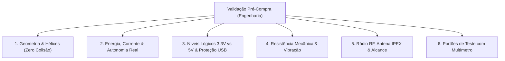

# Validação de Engenharia & BOM Otimizada v2.0 (Quadricóptero 450 mm ESP32-S3)

Antes de comprar um único parafuso ou ligar o ferro de solda, um projeto de drone precisa passar pelo mesmo método usado em engenharia aeroespacial e robótica: **validação analítica por subsistemas + análise de modos de falha (FMEA)**. É assim que garantimos no papel — com matemática e especificações de datasheet — que o projeto **vai funcionar de primeira** e não vai queimar na bancada nem cair por um detalhe bobo.

---

## Parte 1: "Vai Dar Certo?" — Os 6 Pilares de Validação e as 7 Armadilhas que Corrigimos

Ao submeter o nosso rascunho anterior a uma auditoria rigorosa de bancada e de disponibilidade no mercado brasileiro, **identificamos e corrigimos 7 armadilhas reais** que costumam derrubar projetos caseiros de quadricóptero com ESP32.

### Auditoria 1: Geometria e Espaço Físico (As hélices batem? As placas cabem?)
- **Checagem das Hélices `1045` (10 polegadas = `254 mm` de diâmetro / `127 mm` de raio):**
  - Se usarmos uma diagonal motor-a-motor exata de **`D = 450 mm`** (raio `R = 225 mm` do centro até o eixo de cada motor):
  - Distância entre dois motores vizinhos:
    $$L_{adj} = \frac{450}{\sqrt{2}} = 318,2\text{ mm}$$
  - Folga entre as pontas de duas hélices vizinhas girando:
    $$\text{Folga}_{helice} = 318,2 - 254,0 = \mathbf{64,2\text{ mm}\ (6,4\text{ cm})}$$ *(folga excelente e segura)*.
  - Raio livre no centro do drone (sem risco de hélice cortar cabos):
    $$R_{centro\_livre} = 225 - 127 = \mathbf{98\text{ mm}\ (\text{círculo central de } 19,6\text{ cm de diâmetro!})}$$
  - Uma chapa central quadrada de **`12 × 12 cm`** tem canto a `84,8 mm` do centro (`< 98 mm`), sobrando mais de `1,3 cm` além da quina (e `2,3 cm` chanfrando as pontas) — a hélice **nunca** passa sobre a eletrônica nem corta o cabo da bateria se ele estiver preso no centro.
- **CORREÇÃO #1 (Tamanho da Placa Perfurada):**
  - No rascunho inicial, falamos em placa perfurada `5×7 cm` (24 furos de comprimento). Porém, o **`ESP32-S3-DevKitC-1` tem 22 pinos de comprimento (`55,9 mm`)** — ocuparia quase a placa inteira!
  - **Ajuste:** Mudamos para **placa perfurada `7×9 cm` em Fibra de Vidro (FR4 dupla-face estanhada)**. Ela cabe com folga dentro da chapa central `12×12 cm`, não solta ilha de cobre com ferro de solda quente (ao contrário da placa marrom de fenolite) e acomoda confortavelmente o ESP32-S3, a IMU no centro, os conectores dos ESCs e o CI buffer.

---

### Auditoria 2: Propulsão, Corrente de Pico e Autonomia Honesta
- **Motor `A2212 1000KV (13T)` + Hélice `1045` em Bateria `3S (11,1 V)`:**
  - **Em voo pairado (*hover*, ~920 g de peso total → ~230 g por motor):** cada motor consome **~3,2 A** → **~13,1 A totais** (com eletrônica).
  - **Em aceleração máxima (100% throttle):** cada motor gera ~750 g de empuxo e puxa **~14 A a 15,5 A** → pico total de **~56 A a 62 A**.
- **Validação da Mini PDB-XT60 (tipo Matek):**
  - Suporta `25 A × 4` contínuos (`100 A`) e `30 A × 4` de pico (`120 A`). Para os nossos `15 A` máximos por braço, trabalha fria com **mais de 65% de margem de segurança**.
- **Validação da Bateria LiPo 3S (Cálculo Realista):**
  - Uma LiPo `3S 2200 mAh` usando 80% da carga útil (`1760 mAh`) a `13,1 A` entrega **`~8 a 9,5 minutos reais`** de voo misto (não os 15 min otimistas de anúncios!). Se optar por uma `3S 3000 mAh` (+55 g), sobe para **`~11 a 12,5 minutos`**.
  - Como o pico chega perto de `60 A`, uma bateria `2200 mAh` precisa ser de **boa procedência com `30C–45C` reais** (ex.: *Leão Modelismo Ultra*, *Gens Ace*, *Tattu*, *CNHL*). No código do mixer também limitaremos o teto contínuo em 85–90% para preservar a bateria.
- **CORREÇÃO #2 (Material das Hélices — Segurança Crítica!):**
  - As hélices `1045` de plástico **ABS mole/brilhante** que vêm de brinde nos combos baratos dobram sob carga e são famosas por **quebrar uma pá em pleno ar** em drones de ~900 g.
  - **Ajuste:** Usaremos as hélices do combo apenas para testes na gangorra se necessário, e compraremos obrigatoriamente **hélices `1045 de Nylon com Fibra de Carbono` (pretas foscas rígidas)** para voar (~R\$ 35 por 2 pares).

---

### Auditoria 3: Eletrônica e Níveis Lógicos (Onde Projetos ESP32 Queimam ou Falham no Ar)
Aqui estão **3 proteções baratas (< R\$ 10 somadas)** que separam um protótipo amador instável de uma controladora de voo confiável:

1. **CORREÇÃO #3 — Buffer `74HCT125N` entre o ESP32-S3 (3,3 V) e os 4 ESCs (5,0 V):**
   - **O problema oculto:** A maioria dos ESCs 30A baratos (`SimonK` / `Skywalker`) usa um microcontrolador interno de **5,0 V** (`ATmega8A` ou `EFM8`), cujo limiar mínimo de nível alto é $V_{IH} = 0,6 \times 5,0\text{ V} = 3,0\text{ V}$. O ESP32-S3 manda **3,3 V**. Na bancada sem carga funciona, mas quando os motores puxam 40 A, a queda de tensão no fio de `GND` (*ground bounce* de 0,3 V) derruba o sinal visto pelo ESC e causa falhas de sincronia no ar!
   - **A solução de R\$ 5:** Adicionar 1 chip **`SN74HCT125N` (DIP-14)** alimentado em `5 V`. Ele enxerga qualquer tensão acima de `2,0 V` como nível alto e entrega **pulsos quadrados perfeitos de `5,0 V`** para os 4 ESCs, além de funcionar como um "escudo": se um ESC queimar em queda, queima o CI de R\$ 5 num soquete e **salva o seu ESP32-S3**!
2. **CORREÇÃO #4 — Exigir ESC 30A `SimonK` ou `BLHeli` (Fugir de ESC genérico de avião 50 Hz):**
   - Alguns anúncios muito baratos vendem ESC amarelo genérico de aeromodelo (`HW30A` comum), que tem filtro lento na entrada e não responde bem a PWM rápido de **400 Hz** (necessário para o PID corrigir o drone centenas de vezes por segundo). Na BOM, especificamos **`SimonK 30A`**, **`BLHeli_S 30A`** ou **`Hobbywing Skywalker 30A`**.
3. **CORREÇÃO #5 — Diodos Schottky `1N5819` Anti-Retorno (USB + Bateria ao mesmo tempo):**
   - Se a PDB estiver mandando `5 V` no pino `5V` do ESP32-S3 e você espetar o cabo USB no computador (ou no celular Android via OTG no controle), as duas fontes de 5 V brigam entre si!
   - **A solução de R\$ 1:** Colocar 1 diodo Schottky **`1N5819`** em série na entrada de `5 V` externa. Ele deixa passar `~4,75 V` para o regulador interno de `3,3 V` do ESP32-S3 (que só precisa de `> 4,3 V`) e bloqueia 100% qualquer retorno para o PC ou celular!

---

### Auditoria 4: Resistência Estrutural e Montagem Real no Brasil
- **CORREÇÃO #6 — Medidas Reais de Mercado no Brasil (`1/2"` = `12,7 mm`) e Fixação do Motor:**
  - Em serralherias e lojas no Brasil, tubo quadrado de alumínio não é vendido como `12,0 mm`, e sim em polegadas: **`1/2" × 1/2"` (`12,7 × 12,7 mm`, parede `1,0 mm` ou `1,2 mm`)**; e sarrafo de madeira aparelhado é facilmente achado ou lixado em **`13×13 mm` a `15×15 mm`**. Como nosso chassi prensa os braços por cima e por baixo ("sanduíche"), **as mesmas chapas centrais aceitam qualquer espessura entre `12 mm` e `15 mm`** bastando usar parafusos **`M3 × 30 mm`**!
  - **Cálculo estrutural:** Sob manobra forte (`800 gf = 8 N` num único motor), um braço de madeira Pinus/Caixeta de `13×13 mm` com `16 cm` em balanço flete apenas **`~0,65 mm`** e sofre tensão de **`~3,8 MPa`** (a madeira suporta `> 50 MPa` → **fator de segurança > 12× em voo!**). No alumínio `1/2"`, a deflexão cai para **`0,15 mm`**.
  - **Detalhe crucial na ponta do braço:** Como a cruzeta em "X" do motor A2212 é mais larga (`~34 mm`) que o braço (`12,7–15 mm`), parafusaremos o motor **diretamente nos 2 furos longitudinais `M3` da própria base metálica do A2212** (espaçados de `16 mm` ou `19 mm` alinhados ao centro do braço, com um furo central de `8 mm` para alojar a trava do eixo) — economizando `24 g` das cruzetas e mantendo alinhamento perfeito!

---

### Auditoria 5: Link de Rádio ESP-NOW, Antena Externa e Conexão com Celular/Tablet
- **CORREÇÃO #7 — A "Pegadinha" do Jumper de Antena nos ESP32-S3 Vendidos no Brasil:**
  - Existem **duas versões físicas** vendidas como *"ESP32-S3 N16R8 com conector IPEX"* no Mercado Livre, Usinainfo e AliExpress:
    1. **Módulo `ESP32-S3-WROOM-1U` autêntico Espressif:** **NÃO possui antena impressa** no topo da plaquinha metálica (só tem o conector dourado IPEX). Nele, a antena externa já vem ativa de fábrica!
    2. **Placa clone `YD-ESP32-S3 N16R8` (muito comum e barata):** Possui **TANTO a antena impressa preta QUANTO o conector IPEX ao lado**. Ela vem de fábrica ligada na antena interna! Para ativar o conector IPEX, há um **jumper minúsculo de 3 ilhas logo ao lado da blindagem metálica** onde você precisa mover o resistor `0 Ω` (ou fazer uma micro-ponte de solda) para a posição da antena externa. *(Explicamos o passo a passo exato no Manual de Montagem — sem isso, o alcance morre em 50 metros!).*
- **Comunicação Controle ↔ Celular/Tablet (Dupla Redundância):**
  - O `ESP32-S3-DevKitC-1` tem **2 portas USB-C**: usaremos a porta **`USB` nativa (`GPIO19/20`, protocolo USB CDC ACM padrão)** para ligar via cabo OTG no **QGroundControl** (reconhecida nativamente pelo Android sem problemas de driver de chips paralelos). Além disso, como o ESP32-S3 tem **Bluetooth Low Energy 5.0 (BLE)**, também podemos transmitir MAVLink sem fio no futuro se quiser deixar o tablet apoiado num tripé sem cabo!

---

## Parte 2: Lista de Materiais Otimizada (BOM v2.0) e Estratégia de Compras

### Estratégia Inteligente para Economizar R\$ 200+ no Brasil
- **Compre no AliExpress (aba *Choice* — frete grátis acima de R\$ 99, impostos do Remessa Conforme já inclusos no carrinho, entrega em ~10–16 dias):** Módulos eletrônicos específicos que custam 2× a 3× mais caro no varejo local (`2× ESP32-S3 IPEX + Antenas`, `IMU ICM-42688-P`, `BMP280`, `Mini PDB-XT60`, `Gimbals RC`, `OLED 0,96"`, `Hélices 1045 Nylon-Carbono`).
- **Compre no Brasil (Mercado Livre / Shopee Nacional / Lojas locais):**
  1. **Bateria LiPo 3S** (baterias puras têm frete aéreo caríssimo ou proibido da China — compre sempre estoque nacional: *Mercado Livre*, *RoboCore*, *Action Modelismo*, *Banggood/AliExpress armazém BR*).
  2. **Madeira, perfil de alumínio `1/2"`, parafusos M3, espuma, caixa Patola** (ferragens/madeireira local).
  3. **Combo 4× Motores A2212 + 4× ESC 30A** e **Carregador** (compare o preço final com imposto no AliExpress vs. Mercado Livre Full — muitas vezes a diferença é de apenas R\$ 20–30 e chega no dia seguinte no ML com garantia de troca imediata se 1 ESC vier com defeito!).

---

### Tabela 1 — Eletrônica & Propulsão do Drone (BOM v2.0 Fechada)

| # | Componente | Especificação Exata (O que conferir no anúncio) | Qtd | Onde Comprar (Melhor Opção) | Termo de Busca Exato | Preço AliExpress c/ taxas (R\$) | Preço Brasil ML/Lojas (R\$) |
| :-: | :--- | :--- | :-: | :--- | :--- | :---: | :---: |
| **D1** | **MCU Voo** | `ESP32-S3-DevKitC-1 N16R8` **com conector IPEX** (`WROOM-1U` ou `YD-ESP32-S3 IPEX`) | 1 | AliExpress Choice ou Usinainfo/ML | `ESP32-S3 N16R8 IPEX antenna` | 38–52 | 65–90 |
| **D2** | **Antena 2.4 GHz** | Antena omnidirecional **2.4 GHz 3 dBi** + cabo Pigtail **IPEX1 (U.FL) → SMA** *(atenção p/ casar SMA macho/fêmea ou RP-SMA!)* | 1 kit | Comprar junto c/ D1 | `2.4GHz antenna IPEX SMA pigtail` | 10–18 | 18–28 |
| **D3** | **IMU SPI** | Módulo **ICM-42688-P** (6 eixos SPI, 3,3 V) — *Alternativa equivalente:* módulo **BMI270** SPI | 1 | AliExpress Choice ou ML Internacional | `ICM-42688-P module SPI` ou `BMI270 module` | 28–45 | 55–85 |
| **D4** | **Barômetro** | Módulo **BMP280 3.3V** (plaquinha roxa GY-BMP280, I2C) | 1 | AliExpress ou Loja BR | `Modulo BMP280 3.3V` | 6–10 | 10–18 |
| **D5** | **Combo Motores + ESCs** | **4× Motor A2212 1000KV (13T)** c/ conectores banana 3,5 mm soldados + **4× ESC 30A `SimonK` ou `BLHeli`** *(evitar ESC sem nome de 50 Hz; se puder pegar +1 motor/ESC reserva, ótimo!)* | 1 kit (4+4) | Mercado Livre Full / Shopee BR ou AliExpress | `Kit 4 motor A2212 1000kv ESC 30A SimonK` | 210–270 | 260–340 |
| **D6** | **Hélices de Voo** | **4 pares (8 un.) Hélice `1045` (10×4.5) Nylon + Fibra de Carbono** (2 pares CW + 2 pares CCW, rígidas pretas foscas, c/ anéis adaptadores 6 mm) | 4 pares | AliExpress Choice ou ML | `Helice 1045 nylon fibra carbono drone` | 28–42 | 45–75 |
| **D7** | **Mini PDB + BEC** | **PDB-XT60 com BEC 5V/2A e 12V** (tipo *Matek PDB-XT60*, 36×50 mm, já vem c/ conector XT60 macho p/ soldar) | 1 | AliExpress Choice ou ML | `PDB XT60 BEC 5V 12V Matek` | 18–28 | 35–55 |
| **D8** | **Buffer PWM 5V** | CI **`SN74HCT125N`** (ou `74AHCT125N`) **DIP-14** + **Soquete DIP-14** | 1 + 1 | Loja Eletrônica BR (Baú/Usinainfo/ML) | `CI 74HCT125 DIP-14` | — | 5–10 |
| **D9** | **Placa Controladora** | **Placa universal perfurada `7×9 cm` em Fibra de Vidro (FR4) ilhas estanhadas** (passo 2,54 mm) + **3× Barras de pinos fêmea 1×40** + **2× Barras de pinos macho 1×40** | 1 kit | Loja Eletrônica BR / Shopee / ML | `Placa ilhada fibra de vidro 7x9cm` | 15–22 | 22–35 |
| **D10** | **Passivos & Alerta** | 1× Capacitor **`1000 µF 25V Low-ESR`** (105°C), 2× Diodos Schottky **`1N5819`**, Kit resistores (`10 kΩ`, `33 kΩ`, `100 kΩ`), 5× Capacitores cerâmicos **`100 nF` (código 104)**, 1× Capacitor eletrolítico **`10 µF 16V`**, 1× **Módulo Buzzer Ativo 5V** | 1 kit | Loja Eletrônica BR | *(mesmo carrinho de D8/D9)* | — | 18–28 |

---

### Tabela 2 — Chassi Híbrido 450 mm & Amortecimento (Sem Impressora 3D)

| # | Componente | Especificação Exata | Qtd | Onde Comprar | Preço no Brasil (R\$) |
| :-: | :--- | :--- | :-: | :--- | :---: |
| **M1** | **Braços Fase 1 (Madeira)** | Sarrafo quadrado aparelhado reto **`13×13 mm` a `15×15 mm`** (Pinus seco sem nós, Caixeta ou Marfim) — barra de 1 metro (rende os 4 braços de `22,5 cm`) | 1 m | Madeireira / Leroy Merlin / Marcenaria | 8–15 |
| **M2** | **Braços Fase 2 (Alumínio)** | Perfil tubo quadrado de alumínio **`1/2" × 1/2"` (`12,7×12,7 mm`), parede `1,0 mm` ou `1,2 mm`** — 1 metro *(opcional comprar agora ou depois)* | 1 m | Serralheria / Ferragens / ML | 18–28 |
| **M3** | **Chapas Centrais** | Compensado naval ou virola **`4 mm`** (retalho de `30×30 cm` p/ cortar 2 chapas `12×12 cm` + peças da gangorra de teste!) | 1 retalho | Madeireira / Marcenaria (muitas vezes dão retalho de graça!) | 0–15 |
| **M4** | **Kit Parafusos M3** | **16× `M3 × 30 mm`** (centro), **12× `M3 × 20 mm`** (motores), **4× `M3 × 16 mm`**, **30× Porcas autotravantes `M3 Parlock/Nyloc`**, **50× Arruelas lisas `M3`** | 1 kit | Casa de parafusos local / Shopee | 18–28 |
| **M5** | **Amortecimento & Fixação** | **4× Dampers anti-vibração M3 de borracha** (p/ FC) **OU** rolo de **Fita Dupla-Face Espuma Acrílica `3M VHB`**, **1× Cinta Velcro 20 cm** p/ bateria, **Pacote abraçadeiras nylon** (`2,5×100 mm` e `3,6×150 mm`), **Espuma isolante de tubo Ar-Condicionado** (p/ pés de pouso), **Termorretrátil sortido** | 1 kit | Ferragens / Shopee / ML | 25–40 |

---

### Tabela 3 — Controle Caseiro (Estação Base ESP-NOW + OLED + MAVLink)

| # | Componente | Especificação Exata | Qtd | Onde Comprar | Preço AliExpress c/ taxas (R\$) | Preço Brasil (R\$) |
| :-: | :--- | :--- | :-: | :--- | :---: | :---: |
| **T1** | **MCU Solo** | `ESP32-S3-DevKitC-1 N16R8` **com conector IPEX** + **Antena 2.4 GHz 3–5 dBi c/ Pigtail SMA** | 1 kit | Comprar junto c/ D1/D2 | 48–70 | 83–118 |
| **T2** | **Gimbals RC** | **Opção A (Nova):** Par de Gimbals de reposição **`FlySky FS-i6 / i6X` (Mode 2: 1 Throttle sem mola + 1 Pitch/Roll com mola)**, potenciômetro **Opção B (Garimpo BR):** Rádio RC usado/quebrado na OLX/ML (ex.: FlySky/Turnigy/Syma grande queimado — já vem com carcaça + 2 gimbals!) | 1 par | AliExpress (`Replacement Gimbal Flysky FS-i6`) ou OLX/ML | 45–68 | 40–90 (garimpo/ML) |
| **T3** | **Tela Telemetria** | Display **OLED `0,96"` I2C SSD1306** (4 pinos: `GND, VCC, SCL, SDA`, branco ou azul) | 1 | AliExpress ou Loja BR | 10–15 | 18–26 |
| **T4** | **Chaves, Placa & Caixa** | 1× Chave alavanca metálica 2 pos. (`ON-OFF`, **Kill-Switch**), 1× Chave alavanca 3 pos. (`ON-OFF-ON`, **Modos**), 1× Push-button, 1× Buzzer ativo 3,3V/5V, 1× Placa perfurada `5×7 cm` ou `7×9 cm`, **Caixa Plástica `Patola PB-114` (ou similar ~`15×10×5 cm`)** *(dispensável se usar Opção B de carcaça RC)* | 1 kit | Loja Eletrônica BR | — | 35–50 |
| **T5** | **Energia Controle & OTG** | **Opção Simples:** Powerbank USB pequeno que você já tenha em casa (`R$ 0`) **Opção Embutida:** 1× Célula `18650` real + suporte 18650 + módulo `TP4056 USB-C c/ proteção` + mini step-up `MT3608 / 5V` + chave liga/desliga; + **1× Cabo USB-C ↔ USB-C OTG de dados** | 1 kit | Loja Eletrônica BR | — | 15–45 |

---

### Tabela 4 — Bateria LiPo 3S & Carregador Balanceador (Comprar no Brasil!)

| # | Componente | Especificação Recomendada | Qtd | Preço no Brasil (R\$) | Orientação Honesta |
| :-: | :--- | :--- | :-: | :---: | :--- |
| **B1** | **Bateria de Voo** | **LiPo `3S (11,1 V) 2200 mAh` (ou `2600–3000 mAh`) `30C a 45C` com plugue `XT60`** *(ex.: Leão Modelismo Ultra, Gens Ace, Tattu, ZOP/Looybat de boa loja)* | 1 | **145–235** | Peça mais crítica de comprar no Brasil com garantia. Nunca deixe cair abaixo de `10,2 V` (`3,4 V/célula`). |
| **B2** | **Carregador** | **Opção Recomendada:** **`iMAX B6` (80W) + Fonte 12V 5A** *(mostra mAh carregados, mede cada célula e tem modo **Storage 3,85V** p/ bateria durar anos!)* **Opção Econômica:** Carregador balanceador simples **`B3 Pro 2S/3S` (20W)** + **`LiPo Alarm Buzzer` digital** (~R\$ 18) p/ ler tensão das células | 1 | **140–190** *(iMAX B6)* ou **55–80** *(B3 + Buzzer)* | Se o orçamento inicial estiver apertado, o `B3 Pro + LiPo Buzzer` economiza ~R\$ 100 e funciona, exigindo apenas não guardar a bateria 100% cheia por semanas. |

---

### Resumo Realista de Custos (Já com Impostos/Fretes Médios)

| Cenário de Compra | Drone + Chassi Completo | Controle Caseiro Completo | Bateria 3S + Carregador | **TOTAL REAL DO PROJETO** |
| :--- | :---: | :---: | :---: | :---: |
| **1. Compra Mista Otimizada** *(Eletrônica AliExpress Choice + Mecânica/LiPo no Brasil + Carregador B3 + Powerbank próprio)* | ~R\$ 430 | ~R\$ 145 | ~R\$ 210 | **~R\$ 785** |
| **2. Config. "Padrão Ouro" Recomendada** *(Mista AliExpress + Brasil + iMAX B6 + Alumínio extra + 18650 interna)* | ~R\$ 485 | ~R\$ 180 | ~R\$ 330 | **~R\$ 995** |
| **3. 100% Pronta-Entrega no Brasil** *(Tudo via Mercado Livre / Lojas Nacionais em 2–4 dias)* | ~R\$ 630 | ~R\$ 230 | ~R\$ 350 | **~R\$ 1.210** |
