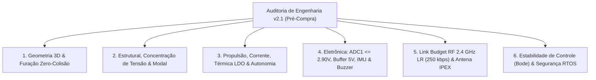

# Validação de Engenharia Multidisciplinar, FMEA & BOM Definitiva v2.1 — Quadricóptero 450 mm ESP32-S3

Antes de comprar um único parafuso ou aquecer o ferro de solda, este documento consolida toda a **engenharia analítica, estrutural, modal, elétrica, de rádio (RF) e de controle** do projeto **ESP32-S3 Quad-450 (Fase 1 Completa — Sem GPS)**. Cada dimensão mecânica, valor de resistor, escolha de sensor e margem de segurança foi recalculado contra os datasheets oficiais da Espressif, TDK InvenSense, Bosch e Texas Instruments e validado em simulação física 6-DoF + Monte Carlo de 100 voos.

---

## Parte 1: Os 6 Pilares de Engenharia e as 14 Armadilhas Reais Mitigadas (v2.1)

Projetos caseiros de drones 450 mm com ESP32 quase sempre falham na bancada ou no primeiro voo por detalhes sutis entre mecânica, níveis analógicos/digitais e vibração. Na revisão **v2.1**, auditamos e eliminamos **14 modos críticos de falha (FMEA)** antes da compra das peças:

---

### Pilar 1: Geometria 3D, Folga de Hélices e Furação Sem Colisão

1. **Geometria `Quad-X` Verdadeira (`D = 450 mm`, Raio Motor `R = 225 mm`) com Hélices `1045` (`Ø 254 mm`, `r_p = 127 mm`):**
   - Distância centro-a-centro entre motores adjacentes:
     $$L_{\text{adj}} = \frac{450}{\sqrt{2}} = 318,20\text{ mm}$$
   - Folga livre entre pontas de hélices vizinhas:
     $$\Delta_{\text{helice}} = 318,20 - 254,00 = \mathbf{64,20\text{ mm}\ (6,4\text{ cm})}$$
   - Raio central 100% livre do disco das hélices:
     $$R_{\text{livre}} = 225,0 - 127,0 = \mathbf{98,0\text{ mm}}\quad (\text{círculo livre de } 196\text{ mm de diâmetro})$$
   - Como as chapas centrais medem **`120 × 120 mm`** (quina a $60\sqrt{2} = 84,85\text{ mm} < 98,0\text{ mm}$, ou `~77,8 mm` chanfrando `10 mm` nos cantos), **nenhuma hélice jamais cruza sobre a chapa central, PDB ou cabos presos no centro**.

2. **[ARMADILHA #1 RESOLVIDA] Tamanho Real da Placa Controladora (`70 × 90 mm` FR4):**
   - O módulo `ESP32-S3-DevKitC-1` possui `22 pinos` por fileira (`~55,9 mm` de comprimento). Uma placa `5×7 cm` não deixaria espaço para conectores e amortecedores. Adotamos **placa universal perfurada `7×9 cm` (`70 × 90 mm`) em Fibra de Vidro FR4 dupla-face estanhada** (nunca fenolite marrom, que levanta ilhas no calor e trinca sob vibração).

3. **[ARMADILHA #2 RESOLVIDA — v2.1] Eliminação de Colisão Geométrica entre Dampers M3 da FC e Braços Diagonais:**
   - Os 4 braços entram nas diagonais a $\pm 45^\circ$ (da ponta interna `r = 20 mm` até a borda da chapa). A distância perpendicular de um furo $(x, y)$ até o eixo central do braço diagonal ($|x| = |y|$) é:
     $$d_\perp = \frac{||y| - |x||}{\sqrt{2}}$$
   - **Por que o padrão quadrado/largo antigo `(±30, ±40) mm` falhava:** com $x = 30, y = 40$, tem-se $d_\perp = 10/\sqrt{2} = 7,07\text{ mm}$. Somando meia largura de um braço de `15 mm` (`7,50 mm`) + metade da porca/damper M3 (`3,50 mm` = `11,00 mm` necessários), ocorria **interferência física de `-3,93 mm`** (o parafuso do damper batia em cima do braço!).
   - **Gabarito Oficial v2.1 (`X = ±22 mm` Largura Esq-Dir × `Y = ±42 mm` Comprimento Frente-Trás):**
     $$d_\perp = \frac{|42 - 22|}{\sqrt{2}} = \mathbf{14,14\text{ mm}}$$
     - No braço de madeira `15×15 mm`: folga livre real de **`+3,14 mm`** para porca/damper M3!
     - No braço de alumínio `12,7×12,7 mm` (`1/2"`): folga livre real de **`+4,29 mm`**!
     - Na placa perfurada `70 × 90 mm`: os furos ficam a `13,0 mm` das bordas laterais (`35 - 22`) e `3,0 mm` de borda livre além da cabeça/porca M3 nas extremidades longitudinais (`45 - 42 = 3 mm`, ou centro do furo a `4,5 mm` da borda caso prefira usar `Y = ±40,5 mm` mantendo $d_\perp = 13,08\text{ mm}$ com `+2,08 mm` de folga livre!). Padronizamos **`X = ±22,0 mm, Y = ±41,0 mm`** (furos a `4,0 mm` da borda superior/inferior da placa `70×90 mm` e $d_\perp = 13,44\text{ mm} \Rightarrow +2,44\text{ mm}$ a `+3,59 mm` de folga limpa dos braços!).

---

### Pilar 2: Engenharia Estrutural, Reações nos Parafusos e Ressonância Modal

1. **Cálculo Completo com Efeito Alavanca nos Parafusos (`r = 32 mm` e `r = 68 mm`) e Furo `Ø 3,2 mm`:**
   - Em cada braço, o eixo do motor está em `R = 225 mm` e os dois parafusos `M3` do sanduíche central ficam em $r_1 = 32\text{ mm}$ e $r_2 = 68\text{ mm}$ ($\Delta r = 36\text{ mm}$, balanço livre $L_c = 225 - 68 = 157\text{ mm}$).
   - Sob empuxo máximo de 1 motor ($F_{\max} = 0,90\text{ kgf} = 8,83\text{ N}$):
     - Reação de tração/apoio no parafuso externo (`68 mm`):
       $$R_{\text{ext}} = F_{\max}\frac{225 - 32}{68 - 32} = 8,83 \times 5,361 = \mathbf{47,3\text{ N}}\quad (\mathbf{142\text{ N}}\text{ em impacto de pouso } 3G)$$
     - Momento fletor máximo exatamente na seção furada em `r = 68 mm`:
       $$M_{\max} = 8,83 \times 0,157 = \mathbf{1,386\text{ N}\cdot\text{m}}$$
   - Descontando o furo vertical `Ø 3,2 mm` ($I_{\text{net}} = \frac{(b - d)h^3}{12}$) e aplicando fator de concentração de tensão elástica $K_t \approx 2,1$ no alumínio (e redistribuição fibrosa na madeira impregnada com cianoacrilato):

| Opção de Braço (`225 mm`) | Massa (4 un.) | Tensão Líquida Máx. 1G / 3G | Deflexão na Ponta (`1G`) | 1ª Freq. Natural $f_{n1}$ (c/ motor `57 g` na ponta) | Veredito de Engenharia v2.1 |
| :--- | :---: | :---: | :---: | :---: | :--- |
| ~~Madeira Pinus `13×13 mm`~~ | ~148 g | 4,7 MPa / 14,1 MPa | 0,88 mm | **76,6 Hz** ❌ | **REPROVADO / REMOVIDO:** $f_{n1}$ cai exatamente em cima da rotação 1× de *hover* (`3800–4600 RPM = 63–77 Hz`), amplificando vibração na IMU! |
| **Madeira Maciça `15×15 mm`** *(Pinus seco s/ nós, Caixeta, Cedrinho ou Freijó)* | **~185 g** | **2,9 MPa / 8,8 MPa** *(FS > 5,5× até em 3G!)* | **0,49 mm** | **101,3 Hz** ✅ | **APROVADO FASE 1 (Mínimo Obrigatório `15×15 mm`):** $f_{n1}$ fica **+42% acima** da fundamental de *hover* (`71 Hz`), sem ressonância! |
| **Tubo Alumínio `1/2" × 1/2"` (`12,7 mm`, parede `1,0–1,2 mm`, liga 6063-T5)** | **~136–158 g** | **26,8 MPa / 80,4 MPa** *(c/ $K_t$, limite 145 MPa → FS = 1,8× em 3G)* | **0,16 mm** | **137,2 Hz** ✅ | **PADRÃO OURO ESTRUTURAL:** Mais leve e 3× mais rígido que madeira; **exige bucha interna de madeira de `55 mm`** na raiz para o aperto M3 não esmagar o tubo! |

2. **[ARMADILHA #3 RESOLVIDA] Hélices Rígidas `1045 Nylon + Fibra de Carbono`:**
   - Hélices plásticas ABS brilhantes/coloridas de combos baratos sofrem *flutter* aeroelástico e partem a pá em voo acima de `800 g`. É **obrigatório** usar hélices **`1045` de Nylon preto fosco reforçado com Fibra de Carbono**.

---

### Pilar 3: Propulsão, Orçamento de Massa, Corrente e Térmica

| Subsistema do Drone (Configuração Fase 1 Completa) | Massa Realista (g) | Notas de Projeto |
| :--- | :---: | :--- |
| 2× Chapas compensado naval `4 mm` (`120×120 mm`, chanfradas) + 4× Braços (`15×15 mm` madeira ou `1/2"` Al) + Parafusos/Porcas Parlock M3 | 215–240 g | Alumínio `1/2" × 1,0 mm` c/ buchas fica ~25 g mais leve que madeira `15×15 mm` |
| Pés de pouso em espuma isolante + abraçadeiras + cinta Velcro | 28 g | Absorve impacto vertical em pousos automáticos de Failsafe |
| 4× Motores `A2212 1000KV (13T)` (fixação direta M3 sem cruzeta de alumínio, economizando `-24 g`!) | 212 g | `53 g` cada com *prop adapter* collet `3,17 mm → 6 mm` |
| 4× ESC `30A SimonK / BLHeli` + 4× Hélices `1045 Nylon-Carbono` | 148 g | `26 g` por ESC + `11 g` por hélice rígida |
| Mini PDB-XT60 + Cap `1000 µF Low-ESR` + Placa `7×9 cm` FR4 + `ESP32-S3` + `74HCT125N` + `ICM-42688-P` + `BMP280` + Antena IPEX | 96 g | Montagem central sobre 4 dampers M3 |
| Bateria LiPo `3S 2200 mAh 35C` (`XT60`) | 188 g | No CG inferior `(0, 0)` |
| **MASSA TOTAL DE DECOLAGEM (`AUW` Fase 1)** | **~887–912 g** | *(Com reserva limpa para `+45 g` do GPS M10 na Fase 2 → `~945 g`)* |

- **Ponto de Operação em Hover (`900 g` = `225 gf` por motor):**
  - Empuxo máximo total (`4 × 770 gf` em `3S` sob carga): **`~3.080 gf` → Relação Empuxo/Peso = `3,4 : 1`**.
  - Comando do mixer em *hover* (`11,1 V`): **`~29% a 34%`** (`~4.250 RPM`, frequência fundamental 1× = `70,8 Hz`, frequência de passagem de 2 pás BPF = `141,7 Hz` — atenuada em **`-26,7 dB`** pelo nosso `BiquadLPF` de `65 Hz`!).
  - Consumo real em *hover*: `~2,95 A × 4 + 0,35 A` (eletrônica/RF) = **`~12,15 A` (`~135 W`)**.
  - **Autonomia honesta (80% de profundidade útil da LiPo):**
    - LiPo `3S 2200 mAh 35C` (`1.760 mAh` úteis): **`8,2 a 9,5 minutos`** de voo real misto.
    - LiPo `3S 3000 mAh 35C` (`2.400 mAh` úteis, `+58 g`): **`11,0 a 12,5 minutos`**.
- **Validação Térmica do LDO `AMS1117-3.3` na placa `ESP32-S3-DevKitC-1`:**
  - Com o diodo Schottky `1N5819` em série no `5,05 V` do BEC da PDB, o pino `5V (IN)` recebe $V_{\text{in}} \approx 4,75\text{ V}$ (acima do *dropout* mínimo `3,3 + 1,1 = 4,40 V` do `AMS1117`, mesmo em pico de corrente Wi-Fi TX!).
  - Dissipação térmica com `ESP32-S3` em `ESP-NOW LR 19,5 dBm` + `ICM-42688-P` + `BMP280` ($I_{\text{médio}} \approx 185\text{ mA}$):
    $$P_{\text{LDO}} = (4,75 - 3,30) \times 0,185 = \mathbf{0,268\text{ W}} \implies \Delta T \approx 0,268 \times 90^\circ\text{C/W} \approx \mathbf{+24^\circ\text{C}}$$
    *(Trabalha morno a `~54 °C` em dia de `30 °C` — folga enorme até o limite de `125 °C`!).*
  - **[ARMADILHA #4 — ALERTA DE CLONE LDO]:** Algumas placas clones ultra-baratas trocam o `AMS1117-3.3` (`SOT-223` grande de `800 mA`) por um minúsculo `ME6211` (`SOT-23-5` de `300–500 mA`). Confira na foto do anúncio se há o regulador `SOT-223` de 4 terminais largos (`AMS1117-3.3`) perto das portas USB-C!

---

### Pilar 4: Eletrônica Analógica, Níveis Lógicos e Sensores (Datasheets Oficiais)

1. **[ARMADILHA #5 RESOLVIDA] Buffer `SN74HCT125N` (`3,3 V → 5,0 V`) para os 4 ESCs + ESCs `400 Hz`:**
   - ESCs `30A` tradicionais (`SimonK` / `BLHeli`) operam com MCU de `5,0 V` ($V_{IH,\min} = 3,0\text{ V}$). Sob `45 A` nos cabos da bateria, um *ground bounce* de `0,35 V` derruba um pulso direto de `3,3 V` abaixo do limiar lógico do ESC!
   - O **`SN74HCT125N` (DIP-14 em soquete)** tem limiar TTL $V_{IH,\min} = 2,0\text{ V}$, aceita `3,3 V` com `1,3 V` de margem de ruído, entrega pulsos perfeitos de **`5,0 V`** a `400 Hz` (`14-bit LEDC`, resolução fina em ponto flutuante de **`0,1526 µs` / `6.553` degraus** entre `1000` e `2000 µs`!) e protege fisicamente o ESP32-S3 se um ESC entrar em curto.

2. **[ARMADILHA #6 RESOLVIDA] Diodos Schottky `1N5819` Anti-Conflito USB / Bateria / OTG:**
   - Isolam o `+5V` do BEC (no Drone) e do módulo Boost `18650` (no Controle) contra o `VBUS` da porta USB-C quando conectado ao PC ou ao celular Android via cabo OTG.

3. **[ARMADILHA #7 RESOLVIDA — v2.1] Teto Real de `2,90 V` do `ADC1` no ESP32-S3 (`VBAT` `39k/10k` + Topo `560 Ω` nos Gimbals):**
   - Segundo o datasheet oficial *ESP32-S3 Series Datasheet (Seção ADC Characteristics)*, mesmo com atenuação máxima (`ADC_11db` / `ADC_ATTEN_DB_12`), o conversor SAR `ADC1` do ESP32-S3 **satura em `4095` por volta de `2.900 mV a 3.100 mV`** (e não em `3.300 mV`!). Isso causava dois problemas graves em projetos comuns:
     - **No Drone (`VBAT`):** Um divisor `33 kΩ / 10 kΩ` gera $12,60 \times \frac{10}{43} = 2,930\text{ V}$, encostando na zona de saturação com LiPo 3S cheia!
       - **Correção v2.1:** Divisor **`39 kΩ` (superior) + `10 kΩ` (inferior) + `100 nF`** (fator `4,90×` no firmware). Em `12,60 V`, $V_{\text{GPIO1}} = \mathbf{2,571\text{ V}}$ (**100% dentro da região linear calibrada de fábrica `eFuse` do ESP32-S3**, suportando leituras lineares até `14,2 V`!).
     - **No Controle (`4× Potenciômetros dos Gimbals`):** Ligar o topo dos potenciômetros direto em `3,30 V` fazia com que os últimos **`12,1%` de curso mecânico do stick** (`2,90 V → 3,30 V`) ficassem cegos/travados em `4095`!
       - **Correção v2.1:** Inserimos **1 único resistor série de `560 Ω` (+ capacitor de desacoplamento `10 µF` p/ `GND`)** entre o pino `3V3` do ESP32-S3 e o barramento positivo comum `+V_POTS` dos 4 potenciômetros:
         - Para potenciômetros padrão `5 kΩ` (4 em paralelo = $R_{\text{eq}} = 1.250\ \Omega$):
           $$V_{\text{POTS,max}} = 3,30 \times \frac{1250}{1250 + 560} = \mathbf{2,28\text{ V}}\quad (\text{ou } \mathbf{2,68\text{ V}} \text{ em potenciômetros de } 10\text{ k}\Omega\text{!})$$
         - Resultado: **100% do curso mecânico de ponta a ponta dos sticks cai na zona mais linear do `ADC1`**, aproveitando toda a resolução sem perda de comando nos extremos, e o *Wizard* de calibração do `ground_tx` normaliza `[raw_min .. raw_max] → [0 .. 1000‰]` automaticamente!

4. **[ARMADILHA #8 RESOLVIDA — v2.1] Escolha Técnica Definitiva da IMU: `ICM-42688-P` SPI (Sem `BMI270`!):**

| Critério Técnico | **`ICM-42688-P` (Escolhida Primária)** | `ICM-42605` / `MPU-6500` SPI *(Backups Automáticos)* | ~~`BMI270`~~ *(Removida da BOM v2.1)* |
| :--- | :---: | :---: | :---: |
| **Ruído do Giroscópio** | **`2,8 mdps/√Hz`** *(classe referência mundial)* | `3,8` a `5,0 mdps/√Hz` | `7,0 mdps/√Hz` *(2,5× mais ruidosa)* |
| **Taxa Nativa Exata `1000 Hz` (`INT1`)** | **SIM (`1,000 kHz` nativo)** | **SIM (`1,000 kHz` nativo)** | **NÃO** *(apenas `800 Hz` ou `1600 Hz`)* |
| **Inicialização SPI** | Registradores diretos (< 5 ms), suportada nativamente em `drv_icm42688_spi.cpp` (`0x47`) | Auto-detectada pelo mesmo driver (`0x42` / `0x70` / `0x71`) sem recompilar! | Exige upload de *blob* binário Bosch de **`8 KB` na RAM a cada boot** + *dummy byte* SPI! |

5. **[ARMADILHA #9 RESOLVIDA — v2.1] Buzzer Ativo 5 V `NPN Active-HIGH` (`KY-012`) & LED RGB Dual (`GPIO48` / `GPIO38`):**
   - **Buzzer:** No mercado existem módulos buzzer de 3 pinos **PNP (`Active-LOW`)** — como no ESP32-S3 o nível alto de um GPIO é `3,3 V` e a base do transistor PNP está em `+4,75 V`, tem-se $V_{EB} = 4,75 - 3,30 = 1,45\text{ V} > 0,7\text{ V}$, fazendo um módulo PNP **apitar sem parar mesmo desligado**! Na BOM v2.1 especificamos módulo **`KY-012` (transistor `NPN J3Y / S8050`, `Active-HIGH`: toca com `3,3 V`, cala com `0 V`)** ou buzzer ativo de **2 terminais** + transistor `2N2222 / BC547`, com teste de multímetro antes de soldar!
   - **LED RGB Onboard:** Placas `ESP32-S3-DevKitC-1 v1.0` e `YD-ESP32-S3` ligam o LED WS2812 no **`GPIO48`**, enquanto a revisão oficial `DevKitC-1 v1.1` mudou para o **`GPIO38`** (ambos 100% livres da Octal PSRAM `GPIO35..37`). Nosso firmware `drone_fc` atualiza ambos (`GPIO48` e `GPIO38`) **apenas quando a cor muda** (eliminando interrupções RMT desnecessárias em voo!).

---

### Pilar 5: Engenharia de RF — Orçamento de Enlace (Link Budget) 2,4 GHz ESP-NOW LR

Na revisão **v2.1**, o driver `drv_espnow_lr.cpp` configura tanto `WIFI_PROTOCOL_LR` puro quanto a taxa explícita por *peer* **`WIFI_PHY_MODE_LR` @ `WIFI_PHY_RATE_LORA_250K`** (250 kbps DSSS com ganho de processamento de espalhamento espectral, sensibilidade de recepção **`-105 dBm`**) já desde o Broadcast inicial e sem poluição de RSSI por roteadores Wi-Fi vizinhos:

- **Equação de Friis em Visada Direta (LOS @ $f = 2,412\text{ GHz}$ — Canal 1):**
  $$\text{FSPL}(d) = 20\log_{10}(d_{\text{km}}) + 20\log_{10}(2412) + 32,44 = 100,09\text{ dB} + 20\log_{10}(d_{\text{km}})$$
  - Potência TX (`esp_wifi_set_max_tx_power(78)`): $+19,5\text{ dBm}$
  - Ganho real líquido das antenas dipolo externas (`3 dBi` nominal `- 0,8 dB` perda pigtail IPEX-SMA, 2 pontas): $+4,4\text{ dB}$
  - Perda adicional de polarização/corpo/zona de Fresnel próxima ao solo: $-8,0\text{ dB}$
  - **Potência recebida a `500 m` (`0,5 km`, $\text{FSPL} = 94,1\text{ dB}$):**
    $$P_{\text{rx}}(500\text{ m}) = 19,5 + 4,4 - 94,1 - 8,0 = \mathbf{-78,2\text{ dBm}}\quad (\text{Margem de } \mathbf{+26,8\text{ dB}} \text{ acima de } -105\text{ dBm!})$$
  - **Potência recebida a `1.000 m` (`1,0 km`, $\text{FSPL} = 100,1\text{ dB}$):**
    $$P_{\text{rx}}(1000\text{ m}) = 19,5 + 4,4 - 100,1 - 8,0 = \mathbf{-84,2\text{ dBm}}\quad (\text{Margem de } \mathbf{+20,8\text{ dB!}})$$
- **[ARMADILHA #10 RESOLVIDA] Jumper `0 Ω` da Antena Externa em Clones `YD-ESP32-S3`:**
  - Módulos `ESP32-S3-WROOM-1U` originais não possuem trilha de antena PCB e já saem ativos no IPEX. Placas `YD-ESP32-S3` vêm com o resistor `0 Ω` virado para a antena PCB interna (`-25 dB` de perda no IPEX se não mover o jumper — detalhado passo a passo no Manual de Montagem!).

---

### Pilar 6: Estabilidade de Controle (Bode) e Segurança de Tempo Real Validada em 6-DoF

As 4 armadilhas finais de software/controle identificadas na auditoria dinâmica foram 100% eliminadas no firmware **v2.1**:
- **[ARMADILHA #11 RESOLVIDA] Margem de Fase Ampliada & Rejeição de Ruído de Hélice:** Filtros ajustados para `GYRO_LPF_HZ = 65 Hz` e `DTERM_LPF_HZ = 35 Hz`, entregando **Margem de Fase de `54,2°`** (cruzamento em `4,2 Hz`), **Margem de Ganho de `14,3 dB`** e atenuação de **`-26,7 dB`** na vibração 2× das pás em *hover* (`142 Hz`).
- **[ARMADILHA #12 RESOLVIDA] Proteção Anti-Capotagem / Anti-*Bounce* em Pouso Inclinado (`P0-CTRL-1`):** Com acelerador zerado (`<= 5%`) no toque em solo inclinado, o mixer suprime o deslocamento ascendente do *Airmode*, drena suavemente o integrador `I` e retorna de `FLYING → ARMED_IDLE` após `1,0 s` imóvel.
- **[ARMADILHA #13 RESOLVIDA] Fallback *Bumpless* se o Barômetro `BMP280` Falhar em Voo (`P0-CTRL-2`):** Se o `BMP280` parar de responder durante `ALT_HOLD` com o stick no meio (`50%`), o controlador remapeia suavemente o centro do stick para o `hover_throttle` real aprendido em voo (`~29%`), impedindo qualquer disparo vertical brusco!
- **[ARMADILHA #14 RESOLVIDA] Isolamento Estrito Dual-Core + Bloqueio de `NVS` Armado + Histerese de Failsafe:**
  - `Flight1kHz` roda sozinha no **Core 1** acionada por ISR em IRAM (`GPIO14`), enquanto `Wire` I2C, `RMT` LED RGB, `ESP-NOW LR` e `USB CDC` (`setTxTimeoutMs` não-bloqueante) rodam isolados em `CommsCore0` / `UiCore0` no **Core 0**.
  - Gravação na Flash `NVS` é **estritamente bloqueada enquanto armado** (evitando congelamento XIP de `25–60 ms` no ar).
  - Saída de `FAILSAFE_DESCEND → FLYING` exige **3 pacotes RC válidos consecutivos** (`<= 150 ms`), enquanto **1 único pacote com `ARM = OFF` corta os motores instantaneamente**!

---

## Parte 2: Lista de Materiais Definitiva (BOM v2.1) e Estratégia de Compras

### Estratégia Inteligente de Compras (Brasil vs. AliExpress Choice)
- **AliExpress (aba *Choice* — frete grátis acima de R\$ 99, impostos Remessa Conforme inclusos no checkout):** `2× ESP32-S3 N16R8 IPEX + Antenas 2.4 GHz`, `IMU ICM-42688-P SPI`, `BMP280 3.3V`, `Mini PDB-XT60 c/ BEC 5V`, `Par de Gimbals FlySky FS-i6 Mode 2`, `OLED 0,96" SSD1306`, `4 pares Hélices 1045 Nylon-Carbono`.
- **Brasil (Mercado Livre / Lojas de Eletrônica e Ferragens Locais):**
  1. **Bateria LiPo `3S 2200–3000 mAh 35C+`** (sempre estoque nacional c/ garantia).
  2. **Madeira `15×15 mm` / Alumínio `1/2"`, compensado `4 mm`, parafusos `M3`, caixa Patola** (madeireira/serralheria/casa de parafusos local).
  3. **Passivos exatos da v2.1** (`SN74HCT125N` + soquete DIP-14, placa FR4 `7×9 cm`, resistores `39 kΩ`, `10 kΩ`, `560 Ω`, `100 kΩ`, diodos `1N5819`, capacitor `1000 µF 25V Low-ESR`, buzzer `KY-012 NPN`).
  4. **Combo `4× A2212 1000KV + 4× ESC 30A SimonK/BLHeli`** e **Carregador Balanceador** (comparar preço final ML Full vs. AliExpress).

---

### Tabela 1 — Eletrônica & Propulsão do Drone (`drone_fc` — BOM v2.1)

| Cód. | Componente | Especificação Exata v2.1 (O que conferir antes de pagar!) | Qtd | Melhor Canal | Termo de Busca Recomendado | AliExpress c/ taxas (R\$) | Brasil ML/Lojas (R\$) |
| :-: | :--- | :--- | :-: | :--- | :--- | :---: | :---: |
| **D1** | **MCU Voo** | **`ESP32-S3-DevKitC-1 N16R8` c/ conector IPEX** (preferir módulo original `WROOM-1U` sem antena PCB e com regulador `AMS1117-3.3 SOT-223`; aceita `YD-ESP32-S3 IPEX` movendo jumper `0 Ω`) | 1 | AliExpress Choice / Usinainfo / ML | `ESP32-S3-WROOM-1U N16R8 DevKitC` | 38–55 | 65–95 |
| **D2** | **Antena 2.4 GHz** | Antena omnidirecional **`2.4 GHz 3 dBi`** + cabo Pigtail **`IPEX1 (U.FL) → SMA`** *(conferir casamento do pino interno: SMA Fêmea c/ pino × Antena SMA Macho, ou RP-SMA casado!)* | 1 kit | Junto c/ D1 | `2.4GHz antenna IPEX U.FL SMA pigtail` | 10–18 | 18–28 |
| **D3** | **IMU Primária SPI** | Módulo **`ICM-42688-P`** (6 eixos SPI `10 MHz`, `3,3 V`, ODR nativo `1 kHz`) — *Não comprar BMI270 nem MPU-6050! (Opcional: +1 `ICM-42688-P` ou `MPU-6500 SPI` reserva)* | 1 | AliExpress Choice / ML | `ICM-42688-P module SPI` | 28–45 | 55–85 |
| **D4** | **Barômetro I2C** | Módulo **`BMP280 3.3V`** (placa roxa `GY-BMP280-3.3`, I2C `0x76`/`0x77`) | 1 | AliExpress / Loja BR | `Modulo GY-BMP280 3.3V` | 6–10 | 10–18 |
| **D5** | **Motores + ESCs** | **4× Motor `A2212 1000KV (13T)`** c/ plugues banana `3,5 mm` soldados + **4× ESC `30A SimonK` ou `BLHeli_S / Skywalker`** *(suporte a PWM `400 Hz`; recomendado +1 motor e +1 ESC sobressalentes!)* | 1 kit (4+4) | ML Full / Shopee BR / AliExpress | `Kit 4 motor A2212 1000kv ESC 30A SimonK` | 210–270 | 260–340 |
| **D6** | **Hélices de Voo** | **4 pares (8 un.) Hélice `1045` (`10×4.5`) Nylon + Fibra de Carbono** (pretas foscas rígidas, 4 CW + 4 CCW, c/ anéis redutores `6 mm`) | 4 pares | AliExpress Choice / ML | `Helice 1045 nylon fibra carbono` | 28–42 | 45–75 |
| **D7** | **Mini PDB + BEC** | **`Mini PDB-XT60` com BEC `5V/2A` regulado** (padrão `36×50 mm` tipo *Matek PDB-XT60* c/ conector XT60 macho incluso) | 1 | AliExpress Choice / ML | `PDB XT60 BEC 5V 12V Matek` | 18–28 | 35–55 |
| **D8** | **Buffer PWM 5V** | CI **`SN74HCT125N`** (ou `SN74AHCT125N` — **deve ter o `"T"` no código!**) **DIP-14** + **1× Soquete DIP-14** | 1 + 1 | Loja Eletrônica BR | `CI SN74HCT125N DIP-14` | — | 5–10 |
| **D9** | **Placa Perf. FR4** | **Placa universal ilhada `7×9 cm` (`70×90 mm`) em Fibra de Vidro FR4 dupla-face estanhada** (passo `2,54 mm`) + **3× Barras fêmea `1×40`** + **2× Barras macho `1×40`** | 1 kit | Loja Eletrônica BR / Shopee | `Placa ilhada fibra de vidro FR4 7x9cm` | 15–22 | 22–35 |
| **D10** | **Passivos & Buzzer v2.1** | 1× Cap. Eletrolítico **`1000 µF 25V Low-ESR (105°C)`**; 3× Diodos Schottky **`1N5819`**; Resistores `1/4W 1%` (**2× `39 kΩ`**, **10× `10 kΩ`**, **2× `560 Ω`**, **4× `100 kΩ`**); 10× Cap. Cerâmicos **`100 nF` (`104`)**; 2× Cap. Eletrolíticos **`10 µF 16V`**; 1× **Buzzer Ativo 5V `NPN Active-HIGH` (`KY-012` c/ transistor `J3Y/S8050`)** | 1 kit | Loja Eletrônica BR | *(mesmo pedido de D8/D9)* | — | 20–32 |

---

### Tabela 2 — Chassi Híbrido 450 mm & Isolamento de Vibração (Sem Impressora 3D)

| Cód. | Componente | Especificação Exata v2.1 | Qtd | Onde Comprar | Preço no Brasil (R\$) |
| :-: | :--- | :--- | :-: | :--- | :---: |
| **M1** | **Braços Madeira (`15×15 mm`)** | Sarrafo quadrado aparelhado reto **`15×15 mm`** (**mínimo `15 mm` para $f_{n1} > 100\text{ Hz}$!** Pinus seco sem nós, Caixeta, Cedrinho ou Marfim) — barra de `1 m` (corta 4× `225 mm` + buchas) | 1 m | Madeireira / Leroy Merlin / Marcenaria | 10–18 |
| **M2** | **Braços Alumínio (`1/2"`)** | Tubo quadrado de alumínio **`1/2" × 1/2"` (`12,7×12,7 mm`), parede `1,0 mm` ou `1,2 mm`** (liga `6063-T5`) — barra de `1 m` *(pode usar já na Fase 1 com buchas internas de madeira `55 mm` ou guardar p/ upgrade!)* | 1 m | Serralheria / Ferragens / ML | 18–28 |
| **M3** | **Chapas Centrais** | Compensado naval ou virola **`4 mm` (5 folhas)** — retalho `30×30 cm` (rende 2 chapas `120×120 mm` + estrutura da Gangorra 1-Eixo!) | 1 retalho | Madeireira / Marcenaria | 0–15 |
| **M4** | **Fixadores M3** | **12× `M3 × 30 mm`** (sanduíche central), **12× `M3 × 18 mm`** e **12× `M3 × 20 mm`** (motores conforme braço), **8× `M3 × 12 mm`**, **30× Porcas autotravantes `M3 Parlock/Nyloc`**, **60× Arruelas lisas `M3`**, **4× Espaçadores nylon `M3 × 6 mm`** (PDB) | 1 kit | Casa de parafusos / Shopee | 20–32 |
| **M5** | **Dampers & Pouso** | **4× Dampers anti-vibração de borracha `M3` (macho-fêmea ou ilhós `M3`)**, **1× Cinta Velcro `20 cm` + EVA `3 mm`** (bateria), **Abraçadeiras nylon** (`2,5×100 mm` e `3,6×150 mm`), **Espuma isolante de tubo `3/4"`** (pés de pouso), **Espuma porosa preta** (vento BMP280), **Termorretrátil sortido** | 1 kit | Ferragens / Shopee / ML | 25–42 |

---

### Tabela 3 — Controle Remoto Caseiro Long-Range (`ground_tx` — BOM v2.1)

| Cód. | Componente | Especificação Exata v2.1 | Qtd | Onde Comprar | AliExpress c/ taxas (R\$) | Brasil (R\$) |
| :-: | :--- | :--- | :-: | :--- | :---: | :---: |
| **T1** | **MCU Solo + Antena** | **`ESP32-S3-DevKitC-1 N16R8` c/ IPEX (`WROOM-1U`)** + **Antena `2.4 GHz 3–5 dBi` c/ Pigtail IPEX→SMA** | 1 kit | Comprar junto c/ D1/D2 | 48–72 | 83–120 |
| **T2** | **Gimbals RC (Mode 2)** | **Opção A (Nova):** Par de Gimbals de reposição **`FlySky FS-i6 / FS-i6X` Mode 2** (Esquerdo **sem mola** no vertical p/ Throttle; Direito **com mola** nos 2 eixos; potenciômetros `5 kΩ` ou `10 kΩ`) **Opção B (Garimpo):** Rádio RC usado c/ defeito na placa na OLX/ML (aproveita carcaça ergonômica + 2 gimbals!) | 1 par | AliExpress (`Replacement Gimbal Flysky FS-i6`) / OLX | 45–68 | 40–90 |
| **T3** | **HUD Telemetria** | Display **`OLED 0,96"` I2C `SSD1306` (`128×64`, 4 pinos: `GND, VCC, SCL, SDA`)** *(atenção à ordem de `GND` e `VCC` serigrafada na sua placa!)* | 1 | AliExpress / Loja BR | 10–15 | 18–26 |
| **T4** | **Chaves, Placa & Caixa** | 1× Chave alavanca metálica **2 posições `ON-OFF`** (**Kill-Switch `SW1`**), 1× Chave alavanca **3 posições `ON-OFF-ON`** (**Modos `SW2`**), 1× Push-button tátil `12×12 mm` c/ capa (**Botão `[AUX]`**), 1× Buzzer ativo `NPN Active-HIGH` (`KY-012`), 1× Placa FR4 `5×7 cm` ou `7×9 cm`, **Caixa `Patola PB-114` (~`15×10×5 cm`)** | 1 kit | Loja Eletrônica BR | — | 35–52 |
| **T5** | **Energia & Cabo OTG** | **Opção Simples:** Powerbank USB-C compacto (`R$ 0` se já tiver) **Opção Interna:** 1× Célula `18650` autêntica (`2500+ mAh`) + suporte 18650 + `TP4056 USB-C c/ proteção DW01` + step-up `MT3608` ajustado em **`5,00 V` no multímetro antes de ligar!** + chave gangorra liga/desliga + **1× Cabo `USB-C ↔ USB-C` OTG de dados** *(cabo só de carga não transmite MAVLink!)* | 1 kit | Loja Eletrônica BR | — | 15–48 |

---

### Tabela 4 — Bateria LiPo 3S, Carregador Balanceador & Segurança

| Cód. | Componente | Especificação Recomendada | Qtd | Preço no Brasil (R\$) | Orientação Técnica |
| :-: | :--- | :--- | :-: | :---: | :--- |
| **B1** | **Bateria de Voo** | **LiPo `3S (11,1 V) 2200 mAh` (ou `2600–3000 mAh`) `35C a 45C` reais c/ `XT60`** *(Gens Ace, Tattu, CNHL, Leão Modelismo Ultra)* | 1 (ideal 2) | **145–240** | Nunca descarregar abaixo de `10,5 V` sob carga (`3,50 V/célula`) nem guardar 100% cheia por mais de 3 dias. |
| **B2** | **Carregador Balanceador** | **Recomendado:** **`iMAX B6 80W` + Fonte `12V 5A`** *(carrega a `1C = 2,2 A`, mede células individuais e possui modo **Storage `3,85 V/célula`**)* **Econômico:** **`B3 Pro 20W`** + **`LiPo Cell Checker / Buzzer Digital`** + **Saco Anti-Chama (*LiPo Safe Bag*)** | 1 | **145–195** *(iMAX B6)* ou **65–95** *(B3 + Checker + Bag)* | O modo *Storage* do `iMAX B6` multiplica por 3× a vida útil da bateria LiPo. Sempre carregue dentro de uma *LiPo Safe Bag* ou piso cerâmico ventilado. |

---

### Resumo Realista de Investimento Total (v2.1 — Com Impostos/Fretes)

| Perfil de Compra | Drone 450 mm Completo | Controle Long-Range Completo | Energia 3S + Carregador | **Investimento Total** |
| :--- | :---: | :---: | :---: | :---: |
| **1. Misto Econômico** *(AliExpress Choice + Mecânica/LiPo BR + B3 Pro + Powerbank próprio)* | ~R\$ 435 | ~R\$ 148 | ~R\$ 215 | **~R\$ 798** |
| **2. "Padrão Ouro" Recomendado** *(Misto + iMAX B6 + Madeira `15×15` & Alumínio `1/2"` + 18650 interna)* | ~R\$ 490 | ~R\$ 185 | ~R\$ 335 | **~R\$ 1.010** |
| **3. 100% Nacional Pronta-Entrega** *(Mercado Livre Full + Lojas Locais em 2–4 dias)* | ~R\$ 640 | ~R\$ 235 | ~R\$ 355 | **~R\$ 1.230** |

---

## Parte 3: Checklist Rápido de Conferência ao Receber os Pacotes (Antes de Montar)

1. **Pigtail SMA × Antena 2,4 GHz:** Desrosqueie e olhe dentro dos dois conectores dourados: **um lado DEVE ter o pino macho central e o outro lado DEVE ter o furinho fêmea receptáculo**! *(O erro mais comum em compras online é receber RP-SMA sem pino nos dois lados — o conector rosqueia normalmente, mas fica em circuito aberto sem contato de RF!).*
2. **CI Buffer `SN74HCT125N`:** Leia o texto gravado no topo do chip: precisa conter as letras **`HCT`** ou **`AHCT`** (`SN74HCT125N`). Não aceite `74HC125` (sem o `T`), pois a família `HC` pura alimentada em `5 V` exige `3,5 V` na entrada!
3. **Buzzer Ativo (`KY-012`):** Ligue `GND → -`, `VCC → +5V` e encoste `I/O (S)` no `GND`: **deve ficar 100% MUDO**. Agora encoste `I/O (S)` em `+3,3V`: **deve APITAR forte**! *(Se apitar com `I/O` no `GND`, o vendedor enviou um módulo PNP Active-LOW — veja no Manual de Montagem como contornar em 1 minuto removendo o transistor ou invertendo no pino).*
4. **OLED `0,96"` I2C:** Confira a serigrafia dos 2 primeiros pinos: existem lotes `GND - VCC - SCL - SDA` e lotes invertidos `VCC - GND - SCL - SDA`. Siga sempre o texto impresso na placa do seu display, nunca a posição cega!
5. **Módulo `MT3608` (se usar bateria `18650` interna no Controle):** Os módulos `MT3608` vêm de fábrica regulados em `12 V` a `20 V`! Ligue a `18650` nele **sozinho na mesa** e gire o trimpot `15 a 20 voltas` anti-horário medindo com o multímetro até cravar exatos **`5,00 V`** na saída antes de chegar perto do ESP32-S3!
